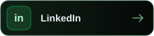
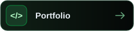
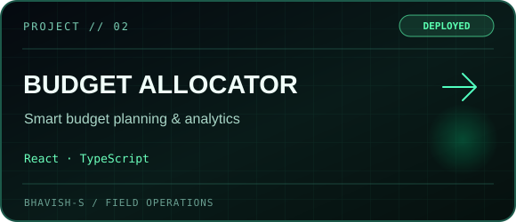
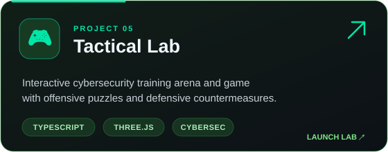

<div align="center">




<p><strong>Ethical Hacking & Pen Testing</strong> &nbsp;·&nbsp; <strong>Workflow Automation</strong> &nbsp;·&nbsp; <strong>DevSecOps & Cloud Defense</strong></p>

<p>
  <a href="https://www.instagram.com/bhavish.s_/"></a>
  <a href="https://www.linkedin.com/in/bhavish-s-/"></a>
  <a href="https://bhavish-s.github.io/Bhavish-S/"></a>
  <a href="mailto:bhavishgowda2006@gmail.com"></a>
</p>

<a href="https://github.com/Bhavish-S">
  
</a>

</div>

---

<h1 align="center">Bhavish S | Cybersecurity Specialist & Automation Engineer</h1>

<p align="center">Cybersecurity Specialist building secure systems, automated security tooling, cloud defense pipelines, and practical DevSecOps workflows.</p>

<h2 align="center">👋 About Me</h2>

<p align="center">
  
</p>

<p align="center">
  <strong>-----------------------------------------</strong><br/>
  Building resilient security architectures and dependable automated workflows.
</p>

I enjoy breaking complex systems to uncover vulnerabilities and building automated defensive mechanisms that make systems unbreakable. Specializing in ethical hacking, penetration testing, SIEM telemetry, and CI/CD DevSecOps automation.

<p align="center">
  <code>CYBERSECURITY & DEFENSE</code> &nbsp;
  <code>WORKFLOW AUTOMATION</code> &nbsp;
  <code>DEVSECOPS + CLOUD</code> &nbsp;
  <code>THREAT INTELLIGENCE & SIEM</code>
</p>

---

## 🧰 Tech Stack

<div align="center">

<p align="center">
  <picture>
    <source media="(prefers-color-scheme: dark)" srcset="./assets/badges/burp-suite.dark.svg" />
    
  </picture>
  <picture>
    <source media="(prefers-color-scheme: dark)" srcset="./assets/badges/metasploit.dark.svg" />
    
  </picture>
  <picture>
    <source media="(prefers-color-scheme: dark)" srcset="./assets/badges/wireshark.dark.svg" />
    
  </picture>
  <picture>
    <source media="(prefers-color-scheme: dark)" srcset="./assets/badges/kalilinux.dark.svg" />
    
  </picture>
  <picture>
    <source media="(prefers-color-scheme: dark)" srcset="./assets/badges/splunk.dark.svg" />
    
  </picture>
  <picture>
    <source media="(prefers-color-scheme: dark)" srcset="./assets/badges/linux.dark.svg" />
    
  </picture>
</p>
<p align="center">
  <picture>
    <source media="(prefers-color-scheme: dark)" srcset="./assets/badges/python.dark.svg" />
    
  </picture>
  <picture>
    <source media="(prefers-color-scheme: dark)" srcset="./assets/badges/bash.dark.svg" />
    
  </picture>
  <picture>
    <source media="(prefers-color-scheme: dark)" srcset="./assets/badges/typescript.dark.svg" />
    
  </picture>
  <picture>
    <source media="(prefers-color-scheme: dark)" srcset="./assets/badges/javascript.dark.svg" />
    
  </picture>
  <picture>
    <source media="(prefers-color-scheme: dark)" srcset="./assets/badges/go.dark.svg" />
    
  </picture>
  <picture>
    <source media="(prefers-color-scheme: dark)" srcset="./assets/badges/c.dark.svg" />
    
  </picture>
</p>
<p align="center">
  <picture>
    <source media="(prefers-color-scheme: dark)" srcset="./assets/badges/docker.dark.svg" />
    
  </picture>
  <picture>
    <source media="(prefers-color-scheme: dark)" srcset="./assets/badges/kubernetes.dark.svg" />
    
  </picture>
  <picture>
    <source media="(prefers-color-scheme: dark)" srcset="./assets/badges/git.dark.svg" />
    
  </picture>
  <picture>
    <source media="(prefers-color-scheme: dark)" srcset="./assets/badges/github-actions.dark.svg" />
    
  </picture>
  <picture>
    <source media="(prefers-color-scheme: dark)" srcset="./assets/badges/firebase.dark.svg" />
    
  </picture>
  <picture>
    <source media="(prefers-color-scheme: dark)" srcset="./assets/badges/react.dark.svg" />
    
  </picture>
</p>

</div>

<sub>Technology badges are crafted with authentic brand vector glyphs and stored directly in this repository. They render natively with instant dark and light mode support.</sub>

---

## 🚀 Featured Projects

<table>
<tr>
<td width="50%" valign="top">

<a href="https://github.com/Bhavish-S/noc"></a>

</td>
<td width="50%" valign="top">

<a href="https://github.com/Bhavish-S/budget-allocator"></a>

</td>
</tr>
<tr>
<td width="50%" valign="top">

<a href="https://github.com/Bhavish-S/Route_Resilience"></a>

</td>
<td width="50%" valign="top">

<a href="https://github.com/Bhavish-S/Novic-Events"></a>

</td>
</tr>
<tr>
<td width="50%" valign="top">

<a href="https://bhavish-s.github.io/Bhavish-S/game/"></a>

</td>
<td width="50%" valign="middle">

### 🌱 More projects

I also experiment with offensive security scripts, penetration testing suites, workflow automation, and cloud defense pipelines.

[**Browse all repositories →**](https://github.com/Bhavish-S?tab=repositories)

</td>
</tr>
</table>

---

## 📊 GitHub Activity

<div align="center">

<picture>
  <source media="(prefers-color-scheme: dark)" srcset="./assets/overview.dark.svg" />
  
</picture>

<picture>
  <source media="(prefers-color-scheme: dark)" srcset="./assets/contributions.dark.svg" />
  
</picture>

<picture>
  <source media="(prefers-color-scheme: dark)" srcset="./assets/languages.dark.svg" />
  
</picture>

<sub>These telemetry cards reflect authentic GitHub activity and render with custom SVG animations.</sub>

### 🐍 Contribution Snake

<picture>
  <source media="(prefers-color-scheme: dark)" srcset="https://raw.githubusercontent.com/Bhavish-S/Bhavish-S/output/github-contribution-grid-snake-dark.svg" />
  <source media="(prefers-color-scheme: light)" srcset="https://raw.githubusercontent.com/Bhavish-S/Bhavish-S/output/github-contribution-grid-snake.svg" />
  
</picture>

</div>

---

## 🤝 Let's Connect

<div align="center">

**Open to:** cybersecurity engineering · ethical hacking · automation workflows · DevSecOps

<p>
  <a href="https://www.instagram.com/bhavish.s_/"></a>
  <a href="https://www.linkedin.com/in/bhavish-s-/"></a>
  <a href="https://bhavish-s.github.io/Bhavish-S/"></a>
  <a href="mailto:bhavishgowda2006@gmail.com"></a>
  <a href="https://discord.gg/QvrjjptH2a"></a>
</p>


<br><br>
⭐️ From [@Bhavish-S](https://github.com/Bhavish-S) · **Building the future, one secure commit at a time** 🚀

</div>

---

### ⚡ Portfolio Web Application

This repository also houses the production source code for **Bhavish's Interactive Portfolio Web Application**, built with **React 19**, **Vite 8**, **Tailwind CSS v4**, **Three.js**, and **Framer Motion**.

#### Quickstart & Local Development

```bash
# Clone the repository
git clone https://github.com/Bhavish-S/Bhavish-S.git
cd Bhavish-S

# Install dependencies
npm install

# Start local development server
npm run dev

# Typecheck and build for production
npm run build
```
