

<!-- ══════════════════════════════════════════════════════════════════════════════
     00 // HERO HEADER & DYNAMIC COMMAND CENTER
     ══════════════════════════════════════════════════════════════════════════════ -->

<a href="https://iambhavishs.vercel.app/" target="_blank" rel="noopener noreferrer">
<picture>
  <source media="(prefers-color-scheme: dark)" srcset="./assets/v2/header.dark.svg" />
  
</picture>
</a>

 

<!-- DYNAMIC TYPING TAGLINE -->

<!-- QUICK-ACTION PILLS -->

  <a href="https://iambhavishs.vercel.app/" target="_blank" rel="noopener noreferrer"><picture><source media="(prefers-color-scheme: dark)" srcset="./assets/v2/pill-portfolio.dark.svg" /></picture></a>&nbsp;
  <a href="https://iambhavishs.vercel.app/assets/Bhavish_S_Resume.pdf" target="_blank" rel="noopener noreferrer"><picture><source media="(prefers-color-scheme: dark)" srcset="./assets/v2/pill-resume.dark.svg" /></picture></a>&nbsp;
  <a href="https://vovalyx.in/" target="_blank" rel="noopener noreferrer"><picture><source media="(prefers-color-scheme: dark)" srcset="./assets/v2/pill-vovalyx.dark.svg" /></picture></a>&nbsp;
  <a href="https://www.linkedin.com/in/bhavish-s-/" target="_blank" rel="noopener noreferrer"><picture><source media="(prefers-color-scheme: dark)" srcset="./assets/v2/pill-linkedin.dark.svg" /></picture></a>&nbsp;
  <a href="mailto:x.bhavish.s@gmail.com"><picture><source media="(prefers-color-scheme: dark)" srcset="./assets/v2/pill-email.dark.svg" /></picture></a>&nbsp;
  <a href="https://www.instagram.com/bhavish_s_/" target="_blank" rel="noopener noreferrer"><picture><source media="(prefers-color-scheme: dark)" srcset="./assets/v2/pill-instagram.dark.svg" /></picture></a>&nbsp;

  <a href="https://github.com/Bhavish-S"><picture><source media="(prefers-color-scheme: dark)" srcset="https://komarev.com/ghpvc/?username=Bhavish-S&style=flat-square&color=00E5A8&labelColor=07131B&label=PROFILE+VIEWS"/></picture></a>

 

<!-- ══════════════════════════════════════════════════════════════════════════════
     01 // WHOAMI & EXECUTIVE DOSSIER
     ══════════════════════════════════════════════════════════════════════════════ -->

<picture>
  <source media="(prefers-color-scheme: dark)" srcset="./assets/v2/s01.dark.svg" />
  
</picture>

> **Bhavish S** is a Google-certified Cybersecurity Specialist, Full-Stack Systems Architect, and Computer Science & Engineering scholar at **Maharaja Institute of Technology, Mysore** (2023–2027).
> 
> He currently serves as **CFO, CRO & Security Lead at [Vovalyx](https://vovalyx.in/)** — a custom software development company in India building bespoke web apps, ERP systems, mobile apps, and automation around real business workflows.
> 
> - 🏛️ **Executive Leadership @ Vovalyx**: Directs financial architecture, risk governance, security posture, and strategic growth across enterprise client deliverables.
> - 🛡️ **Defensive & Offensive Core**: SIEM log analytics, SOC incident triage, automated penetration testing, Zero-Trust RBAC, and threat hardening.
> - 🚀 **Engineering Impact**: Architected and deployed campus-adopted ERP platforms recognized with an **Official Letter of Appreciation from the MITM Principal**, and placed as a finalist in the **ISRO Bharatiya Antariksh Hackathon 2026**.
> - ⚡ **Production Deployments**: 10+ live platforms serving active institutional and enterprise users worldwide.

<picture>
  <source media="(prefers-color-scheme: dark)" srcset="./assets/v2/about.dark.svg" />
  
</picture>

 

<!-- ══════════════════════════════════════════════════════════════════════════════
     02 // THE ROUTE // ENGINEERING MILESTONES
     ══════════════════════════════════════════════════════════════════════════════ -->

<picture>
  <source media="(prefers-color-scheme: dark)" srcset="./assets/v2/s02.dark.svg" />
  
</picture>

<picture>
  <source media="(prefers-color-scheme: dark)" srcset="./assets/v2/timeline.dark.svg" />
  
</picture>

> **The Engineering Path at a Glance:**
> - **2022 · First Commit**: Built core foundations in Linux systems programming, Python automation, and low-level networking.
> - **2023 · B.E. CSE @ MIT Mysore**: Initiated formal computer science degree; began offensive cyber research and SIEM architecture.
> - **2024 · SOC Operations & PenTesting**: Automated vulnerability assessments, security logging, and hands-on CTF reverse engineering.
> - **2025 · Executive Role @ Vovalyx**: Appointed CFO, CRO & Security Lead; co-developed UniConv, MITM PlacePro, AcadOps ERP, and NoDue Portal.
> - **2026 · Institutional Honors**: Verified as Google Cybersecurity Professional, honored with MIT Mysore Principal's Letter of Appreciation, and named Finalist in ISRO Bharatiya Antariksh Hackathon.

 

<!-- ══════════════════════════════════════════════════════════════════════════════
     03 // VOVALYX SOFTWARE STUDIO & PRODUCTION SYSTEMS
     ══════════════════════════════════════════════════════════════════════════════ -->

<picture>
  <source media="(prefers-color-scheme: dark)" srcset="./assets/v2/s03.dark.svg" />
  
</picture>

<a href="https://vovalyx.in/" target="_blank" rel="noopener noreferrer">
<picture>
  <source media="(prefers-color-scheme: dark)" srcset="./assets/v2/studio.dark.svg" />
  
</picture>
</a>

 

<picture>
  <source media="(prefers-color-scheme: dark)" srcset="./assets/v2/manifest.dark.svg" />
  
</picture>

 

### 🏢 Flagship Platforms Co-Engineered at [Vovalyx](https://vovalyx.in/)

<table>
<tr>
<td width="50%" valign="top">
  <a href="https://uniconv-psi.vercel.app/" target="_blank" rel="noopener noreferrer">
    <picture>
      <source media="(prefers-color-scheme: dark)" srcset="./assets/v2/project-uniconv.dark.svg" />
      
    </picture>

  </a>

   

  <b>⚡ <a href="https://uniconv-psi.vercel.app/">UniConv (SaaS)</a></b> · <code>Production Live</code> 
  Universal client-side converter with 256-bit AES encryption, AI watermark removal &amp; zero server persistence.
</td>
<td width="50%" valign="top">
  <a href="https://noc-portal-self.vercel.app/" target="_blank" rel="noopener noreferrer">
    <picture>
      <source media="(prefers-color-scheme: dark)" srcset="./assets/v2/project-nodue-portal.dark.svg" />
      
    </picture>

  </a>

   

  <b>🎓 <a href="https://noc-portal-self.vercel.app/">NoDue Portal</a></b> · <code>Institutional Deployment</code> 
  Campus-wide digital student clearance system replacing physical paper signatures across all MITM departments.
</td>
</tr>
<tr>
<td width="50%" valign="top">
  <a href="https://erp-client-9lbk.vercel.app/" target="_blank" rel="noopener noreferrer">
    <picture>
      <source media="(prefers-color-scheme: dark)" srcset="./assets/v2/project-erp-client.dark.svg" />
      
    </picture>

  </a>

   

  <b>🏛️ <a href="https://erp-client-9lbk.vercel.app/">AcadOps ERP</a></b> · <code>Enterprise Production</code> 
  Academic governance suite with fine-grained RBAC, faculty workload modeling &amp; institutional policy tracking.
</td>
<td width="50%" valign="top">
  <a href="https://mitm-placepro.vercel.app/" target="_blank" rel="noopener noreferrer">
    <picture>
      <source media="(prefers-color-scheme: dark)" srcset="./assets/v2/project-placepro.dark.svg" />
      
    </picture>

  </a>

   

  <b>💼 <a href="https://mitm-placepro.vercel.app/">MITM PlacePro</a></b> · <code>Campus Production</code> 
  Automated campus placement drive management, student eligibility filtering &amp; real-time hiring metrics.
</td>
</tr>
<tr>
<td width="50%" valign="top">
  <a href="https://mitm-rd.vercel.app/" target="_blank" rel="noopener noreferrer">
    <picture>
      <source media="(prefers-color-scheme: dark)" srcset="./assets/v2/project-jnanashodha.dark.svg" />
      
    </picture>

  </a>

   

  <b>🔬 <a href="https://mitm-rd.vercel.app/">MRF / Jnanashodha</a></b> · <code>Institutional Live</code> 
  Maharaja Research Foundation doctoral admissions, candidate tracking &amp; research thesis evaluation portal.
</td>
<td width="50%" valign="top">
  <a href="https://vovalyx.in/products.html" target="_blank" rel="noopener noreferrer">
    <picture>
      <source media="(prefers-color-scheme: dark)" srcset="./assets/v2/project-petcommunity.dark.svg" />
      
    </picture>

  </a>

   

  <b>🐾 <a href="https://vovalyx.in/products.html">PetCommunity</a></b> · <code>Consumer Platform</code> 
  Intelligent pet matchmaking platform, verified veterinary network, and Breed Lab genetics encyclopedia.
</td>
</tr>
</table>

Explore full client case studies and services at <a href="https://vovalyx.in/">vovalyx.in</a> and <a href="https://iambhavishs.vercel.app/">iambhavishs.vercel.app</a>.

 

<!-- 03b // ENGINEERED SYSTEMS & REPOSITORIES (ALL PROJECTS LINKED TO ACCOUNT) -->

### 🛠️ All Engineered Projects & Linked Repositories

The following production repositories and software systems are built, contributed to, and maintained directly under [@Bhavish-S](https://github.com/Bhavish-S):

<table>
<tr>
<td width="50%" valign="top">
  <a href="https://github.com/Bhavish-S/Route_Resilience" target="_blank" rel="noopener noreferrer"><picture><source media="(prefers-color-scheme: dark)" srcset="./assets/v2/repo-route-resilience.dark.svg" /></picture></a>
</td>
<td width="50%" valign="top">
  <a href="https://github.com/Bhavish-S/Claim_Ai" target="_blank" rel="noopener noreferrer"><picture><source media="(prefers-color-scheme: dark)" srcset="./assets/v2/repo-claim-ai.dark.svg" /></picture></a>
</td>
</tr>
<tr>
<td width="50%" valign="top">
  <a href="https://github.com/Bhavish-S/LeafCure" target="_blank" rel="noopener noreferrer"><picture><source media="(prefers-color-scheme: dark)" srcset="./assets/v2/repo-leafcure.dark.svg" /></picture></a>
</td>
<td width="50%" valign="top">
  <a href="https://github.com/Bhavish-S/Liltwise" target="_blank" rel="noopener noreferrer"><picture><source media="(prefers-color-scheme: dark)" srcset="./assets/v2/repo-liltwise.dark.svg" /></picture></a>
</td>
</tr>
<tr>
<td width="50%" valign="top">
  <a href="https://github.com/Bhavish-S/Inklly" target="_blank" rel="noopener noreferrer"><picture><source media="(prefers-color-scheme: dark)" srcset="./assets/v2/repo-inklly.dark.svg" /></picture></a>
</td>
<td width="50%" valign="top">
  <a href="https://github.com/Bhavish-S/budget-allocator" target="_blank" rel="noopener noreferrer"><picture><source media="(prefers-color-scheme: dark)" srcset="./assets/v2/repo-budget-allocator.dark.svg" /></picture></a>
</td>
</tr>
<tr>
<td width="50%" valign="top">
  <a href="https://github.com/Bhavish-S/paws-polish" target="_blank" rel="noopener noreferrer"><picture><source media="(prefers-color-scheme: dark)" srcset="./assets/v2/repo-paws-polish.dark.svg" /></picture></a>
</td>
<td width="50%" valign="top">
  <a href="https://github.com/Bhavish-S" target="_blank" rel="noopener noreferrer"><picture><source media="(prefers-color-scheme: dark)" srcset="./assets/v2/repo-siem-threat-defense.dark.svg" /></picture></a>
</td>
</tr>
<tr>
<td width="50%" valign="top">
  <a href="https://github.com/Bhavish-S" target="_blank" rel="noopener noreferrer"><picture><source media="(prefers-color-scheme: dark)" srcset="./assets/v2/repo-pentest-toolkit.dark.svg" /></picture></a>
</td>
<td width="50%" valign="top">
  <a href="https://github.com/Bhavish-S/Bhavish-S" target="_blank" rel="noopener noreferrer"><picture><source media="(prefers-color-scheme: dark)" srcset="./assets/v2/repo-bhavish-s-portfolio.dark.svg" /></picture></a>
</td>
</tr>
</table>

<b>View as table</b>

| Project | Domain | Architecture & Technologies | Deployment / Status |
| :--- | :--- | :--- | :--- |
| **[Route Resilience](https://github.com/Bhavish-S/Route_Resilience)** | Satellite Analytics / GIS | Satellite road network flood vulnerability modeling, topological graph analysis & dynamic evacuation routing via `Python`, `GeoPandas`, `NetworkX`. | 🛰️ **ISRO BAH 2026 Finalist** |
| **[Claim_Ai](https://github.com/Bhavish-S/Claim_Ai)** | InsurTech / AI Engine | Intelligent insurance claim triage, OCR document validation & automated policy anomaly detection using `TypeScript`, `Next.js`, `AI APIs`. | ⚡ **Active Repository** |
| **[LeafCure](https://github.com/Bhavish-S/LeafCure)** | AgriTech / Computer Vision | Computer vision plant pathology diagnostic system identifying crop diseases with treatment recommendations via `JavaScript`, `Python`, `TensorFlow`. | 🌿 **Active Repository** |
| **[Liltwise](https://github.com/Bhavish-S/Liltwise)** | AI Media Utility | Multi-modal text and audio synthesis engine designed for rapid content workflow automation via `TypeScript`, `React`, `AI APIs`. | 🎧 **Active Repository** |
| **[Inklly](https://github.com/Bhavish-S/Inklly)** | Dev Publishing / CMS | High-speed technical blogging and markdown documentation platform built with `TypeScript`, `Tailwind CSS`, `Next.js`. | ✍️ **Active Repository** |
| **[Budget Allocator](https://github.com/Bhavish-S/budget-allocator)** | FinTech / Analytics | Strategic financial modeling and resource allocation engine supporting zero-based budgeting simulations via `TypeScript`, `React`. | 💰 **Active Repository** |
| **[Paws & Polish](https://github.com/Bhavish-S/paws-polish)** | Booking & Operations SaaS | Professional pet grooming management platform with automated booking, service schedules & notifications via `TypeScript`, `Tailwind CSS`. | 🐕 **Active Repository** |
| **[SIEM Threat Defense](https://github.com/Bhavish-S)** | Offensive & SOC Security | Syslog correlation rules, alert threshold tuning, automated attack simulation, and incident triage using `Splunk`, `ELK`, `Python`, `Bash`. | 🛡️ **Security Core** |
| **[Pentest Toolkit](https://github.com/Bhavish-S)** | Security Automation | Automated vulnerability scanning, network reconnaissance, port enumeration, and payload verification suite via `Python`, `Nmap`, `Burp Suite`. | ⚔️ **Security Core** |
| **[Bhavish-S Portfolio](https://github.com/Bhavish-S/Bhavish-S)** | Web Architecture | Production codebase for the official interactive portfolio web app ([iambhavishs.vercel.app](https://iambhavishs.vercel.app/)) built with `React 19`, `Vite 8`, `Tailwind CSS v4`. | 🚀 **Live Production** |

 

<!-- ══════════════════════════════════════════════════════════════════════════════
     04 // TELEMETRY & LIVE PERFORMANCE MATRIX
     ══════════════════════════════════════════════════════════════════════════════ -->

<picture>
  <source media="(prefers-color-scheme: dark)" srcset="./assets/v2/s04.dark.svg" />
  
</picture>

<!-- 3D ISOMETRIC CONTRIBUTION CITY -->

<picture>
  <source media="(prefers-color-scheme: dark)" srcset="./assets/contributions.dark.svg" />
  
</picture>

 

<!-- LIVE OVERVIEW METRICS (auto-refreshed every 6 hours) -->

<picture>
  <source media="(prefers-color-scheme: dark)" srcset="./assets/stats/overview.dark.svg" />
  
</picture>

 

<!-- LIVE LANGUAGE BREAKDOWN -->

<picture>
  <source media="(prefers-color-scheme: dark)" srcset="./assets/stats/languages.dark.svg" />
  
</picture>

 

<!-- ANIMATED CONTRIBUTION SNAKE (regenerated every 6 hours, emerald palette) -->

<picture>
  <source media="(prefers-color-scheme: dark)" srcset="https://raw.githubusercontent.com/Bhavish-S/Bhavish-S/output/github-contribution-grid-snake-dark.svg" />
  <source media="(prefers-color-scheme: light)" srcset="https://raw.githubusercontent.com/Bhavish-S/Bhavish-S/output/github-contribution-grid-snake.svg" />
  
</picture>

  

 

<!-- TELEMETRY METRICS BAR -->
<picture>
  <source media="(prefers-color-scheme: dark)" srcset="./assets/v2/metrics.dark.svg" />
  
</picture>

 

<!-- ══════════════════════════════════════════════════════════════════════════════
     05 // TECHNICAL ARSENAL // PRODUCTION STACK
     ══════════════════════════════════════════════════════════════════════════════ -->

<picture>
  <source media="(prefers-color-scheme: dark)" srcset="./assets/v2/s05.dark.svg" />
  
</picture>

<picture>
  <source media="(prefers-color-scheme: dark)" srcset="./assets/v2/arsenal.dark.svg" />
  
</picture>

 

<!-- ══════════════════════════════════════════════════════════════════════════════
     06 // VERIFIED CREDENTIALS & ACHIEVEMENTS
     ══════════════════════════════════════════════════════════════════════════════ -->

<picture>
  <source media="(prefers-color-scheme: dark)" srcset="./assets/v2/s06.dark.svg" />
  
</picture>

<picture>
  <source media="(prefers-color-scheme: dark)" srcset="./assets/v2/credentials.dark.svg" />
  
</picture>

 

  <a href="https://github.com/Bhavish-S?tab=achievements" target="_blank" rel="noopener noreferrer">
    <picture>
      <source media="(prefers-color-scheme: dark)" srcset="./assets/dashboard/achievements.dark.svg" />
      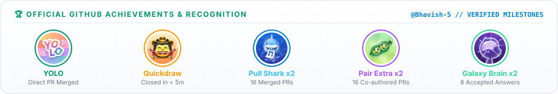
    </picture>

  </a>

 

<!-- ══════════════════════════════════════════════════════════════════════════════
     07 // ESTABLISH SECURE LINK // CONNECT
     ══════════════════════════════════════════════════════════════════════════════ -->

<picture>
  <source media="(prefers-color-scheme: dark)" srcset="./assets/v2/s07.dark.svg" />
  
</picture>

  <a href="https://iambhavishs.vercel.app/" target="_blank" rel="noopener noreferrer"><picture><source media="(prefers-color-scheme: dark)" srcset="./assets/v2/connect-portfolio.dark.svg" /></picture></a>
  <a href="https://www.linkedin.com/in/bhavish-s-/" target="_blank" rel="noopener noreferrer"><picture><source media="(prefers-color-scheme: dark)" srcset="./assets/v2/connect-linkedin.dark.svg" /></picture></a>
  <a href="mailto:x.bhavish.s@gmail.com"><picture><source media="(prefers-color-scheme: dark)" srcset="./assets/v2/connect-email.dark.svg" /></picture></a>
  <a href="https://www.instagram.com/bhavish_s_/" target="_blank" rel="noopener noreferrer"><picture><source media="(prefers-color-scheme: dark)" srcset="./assets/v2/connect-instagram.dark.svg" /></picture></a>
  <a href="https://vovalyx.in/" target="_blank" rel="noopener noreferrer"><picture><source media="(prefers-color-scheme: dark)" srcset="./assets/v2/connect-vovalyx.dark.svg" /></picture></a>

<picture>
  <source media="(prefers-color-scheme: dark)" srcset="./assets/v2/footer.dark.svg" />
  
</picture>

  

⭐️ From [@Bhavish-S](https://github.com/Bhavish-S) · **Building the future, one secure commit at a time** 🚀

---

### ⚡ Portfolio Web Application

This repository also houses the production source code for **Bhavish's Interactive Portfolio Web Application**, live at **[iambhavishs.vercel.app](https://iambhavishs.vercel.app/)**, built with **React 19**, **Vite 8**, **Tailwind CSS v4**, and **Framer Motion**.
