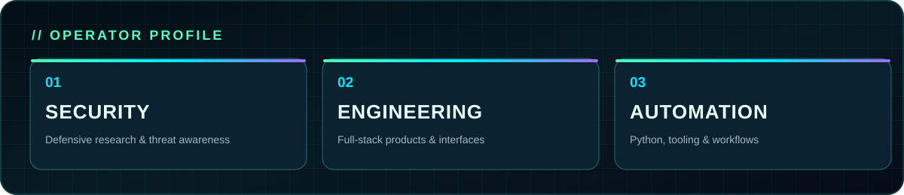
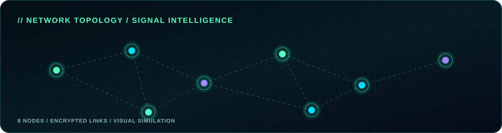
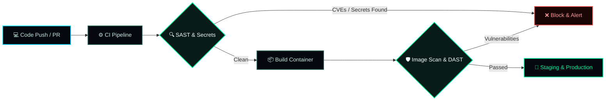
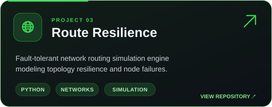
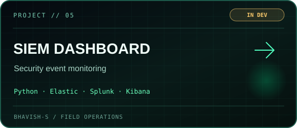
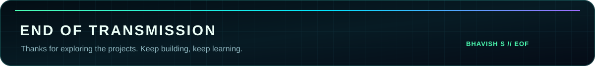

<a id="top"></a>

<!-- ══════════════════════════════════════════════════════════════════════════════
     BHAVISH S — CYBERSECURITY COMMAND CENTER & PORTFOLIO
     Tailored Quantum Cyber Profile • High-Performance Aesthetic
     ══════════════════════════════════════════════════════════════════════════════ -->

<div align="center">
  
  
  <br/>

  <!-- QUICK NAVIGATION HUD -->
  <p align="center">
    <code><a href="#about">DOSSIER</a></code> &nbsp;•&nbsp;
    <code><a href="#pipeline">DEVSECOPS</a></code> &nbsp;•&nbsp;
    <code><a href="#projects">PROJECTS</a></code> &nbsp;•&nbsp;
    <code><a href="#arsenal">ARSENAL</a></code> &nbsp;•&nbsp;
    <code><a href="#intelligence">INTELLIGENCE</a></code> &nbsp;•&nbsp;
    <code><a href="#roadmap">ROADMAP</a></code> &nbsp;•&nbsp;
    <code><a href="#game">TACTICAL LAB</a></code> &nbsp;•&nbsp;
    <code><a href="#connect">CONNECT</a></code>
  </p>

  <!-- TRANSMISSION LINKS -->
  <a href="https://github.com/Bhavish-S"></a>
  <a href="https://www.linkedin.com/in/bhavish-s-/"></a>
  <a href="mailto:bhavishgowda2006@gmail.com"></a>
  <a href="https://discord.gg/QvrjjptH2a"></a>
  <a href="https://twitter.com"></a>
  <a href="https://www.instagram.com/bhavish_s_/"></a>
  <a href="https://bhavish-s.github.io/Bhavish-S/game/"></a>
  <br/><br/>

  <!-- LIVE TELEMETRY BADGES -->
  
  
  
  <br/><br/>

  <!-- DYNAMIC TERMINAL PROMPT -->
  <a href="https://git.io/typing-svg">
    
  </a>
  <br/>

  <!-- NETWORK TOPOLOGY GRAPHIC -->
  
</div>

---

<a id="about"></a>

## 🧠 THREAT DOSSIER — Target Profile

<div align="center">
  <p><b><i>"Understand how to break systems, so you can build unbreakable ones."</i></b></p>
</div>

I am an **Ethical Hacker**, **SOC Analyst**, and **Security Engineer** who approaches defense through the lens of an adversary. I specialize in **Penetration Testing**, **SIEM Architecture**, **Threat Hunting**, and **DevSecOps Automation** — crafting real-world security tooling and full-stack platforms from the ground up in Python, Bash, and modern web frameworks.

By day — a Computer Science Engineering student dissecting kernel internals, network protocols, and distributed architecture.  
By night — an operator tracking vulnerabilities on HackTheBox and TryHackMe, developing custom SIEM dashboards, writing exploit PoCs, and engineering resilient systems.

<table>
<tr>
<td width="54%" valign="top">

```
╔══════════════════════════════════════════════════╗
║         ⚠️  CLASSIFIED — THREAT DOSSIER          ║
╠══════════════════════════════════════════════════╣
║                                                  ║
║  bhavish@kali:~$ whoami                          ║
║                                                  ║
║  ┌─ IDENTITY ─────────────────────────────────┐  ║
║  │  codename    :  Bhavish S                  │  ║
║  │  alias       :  "The Legal Hacker"         │  ║
║  │  base_os     :  Kali Linux / Debian / macOS│  ║
║  │  location    :  India 🇮🇳                   │  ║
║  │  degree      :  B.Tech Computer Science    │  ║
║  │  clearance   :  Security Level 5           │  ║
║  └────────────────────────────────────────────┘  ║
║                                                  ║
║  bhavish@kali:~$ cat /etc/capabilities           ║
║                                                  ║
║  ┌─ OFFENSIVE ────────────────────────────────┐  ║
║  │  [✓] Penetration Testing & Red Teaming     │  ║
║  │  [✓] Web App Security & OWASP Top 10       │  ║
║  │  [✓] Network Recon, Scanning & Exploits    │  ║
║  │  [✓] Privilege Escalation (Linux/Windows)  │  ║
║  │  [✓] Brute Force & Password Auditing       │  ║
║  └────────────────────────────────────────────┘  ║
║  ┌─ DEFENSIVE ────────────────────────────────┐  ║
║  │  [✓] SOC Tier 1/2 Incident Response        │  ║
║  │  [✓] SIEM Engineering (Splunk / Elastic)   │  ║
║  │  [✓] Threat Hunting & MITRE ATT&CK         │  ║
║  │  [✓] Packet Analysis (Wireshark / Tcpdump) │  ║
║  │  [✓] Log Correlation & Detection Rules     │  ║
║  └────────────────────────────────────────────┘  ║
║  ┌─ DEVELOPMENT ──────────────────────────────┐  ║
║  │  [✓] Python Security Scripting & Tooling   │  ║
║  │  [✓] Full-Stack SaaS & Web Applications    │  ║
║  │  [✓] DevSecOps & CI/CD Pipeline Hardening  │  ║
║  │  [✓] Graph Algorithms & Network Simulation │  ║
║  └────────────────────────────────────────────┘  ║
║                                                  ║
║  bhavish@kali:~$ systemctl status bhavish        ║
║                                                  ║
║  [✔] Google CyberSec Cert   — COMPLETED         ║
║  [~] HackTheBox & TryHackMe — ACTIVE GRIND       ║
║  [~] SIEM Dashboard         — IN BUILD           ║
║  [~] PenTest Toolkit        — IN BUILD           ║
║  [*] Collaboration Status   — 🟢 OPEN            ║
║                                                  ║
╚══════════════════════════════════════════════════╝
```

</td>
<td width="46%" valign="top" align="center">


<br/><br/>


<br/><br/>

<div align="left">

**🎯 Core Tactical Focus Areas:**
- 🛡️ **Offensive Mindset**: Emulating APT tactics to locate zero-days, misconfigurations, and broken access controls before malicious actors do.
- ⚙️ **Shift-Left Security**: Baking automated SAST, DAST, dependency audits, and secret scanning directly into developer PR workflows.
- 📡 **Telemetry & Forensics**: Extracting actionable signals from noisy firewall, sysmon, and application logs using SIEM query languages.

</div>

</td>
</tr>
</table>

---

<a id="pipeline"></a>

## ⚙️ SECURE SDLC & DEVSECOPS PIPELINE

My standard operational philosophy integrates continuous security checks across each stage of software delivery:



1. **Shift-Left Static Analysis**: Automated linting, type-checking, and AST-based vulnerability discovery via Semgrep and Bandit.
2. **Secret Detection**: Pre-commit & CI git history scanning with TruffleHog to guarantee no private tokens leak to remotes.
3. **Container Hardening**: Minimal base images, non-root user execution, and container vulnerability scans with Trivy.
4. **Dynamic Testing**: Staging environment health verification and automated web surface scanning with OWASP ZAP.

---

<a id="projects"></a>

## ⚡ FIELD OPS — Featured Deployments

<table>
  <tr>
    <td width="50%" valign="top">
      <a href="https://github.com/Bhavish-S/noc">
        
      </a>
    </td>
    <td width="50%" valign="top">
      <a href="https://github.com/Bhavish-S/budget-allocator">
        
      </a>
    </td>
  </tr>
  <tr>
    <td width="50%" valign="top">
      <a href="https://github.com/Bhavish-S/Route_Resilience">
        
      </a>
    </td>
    <td width="50%" valign="top">
      <a href="https://github.com/Bhavish-S/Novic-Events">
        
      </a>
    </td>
  </tr>
  <tr>
    <td width="50%" valign="top">
      
    </td>
    <td width="50%" valign="top">
      
    </td>
  </tr>
</table>

<details open>
<summary><b>🔍 Detailed Project Architecture & Technical Breakdown</b></summary>
<br/>

| Project | Tech Stack | Security & Architectural Highlights | Status | Link |
|:--------|:-----------|:------------------------------------|:------:|:----:|
| **🔒 NoDue Portal** | React · TypeScript · Node.js · Firebase | **Role-Based Access Control (RBAC)** across 5 campus authorities (Student, HOD, Library, Lab, Finance). Automated cryptographic clearance verification, atomic approval states, and tamper-resistant audit trails. | `DEPLOYED` | [Repository ↗](https://github.com/Bhavish-S/noc) |
| **💰 Budget Allocator** | React · TypeScript · Tailwind CSS | Client-side financial engine with dynamic 50/30/20 budget distribution algorithms, real-time variance calculations, zero-knowledge local storage architecture, and data visualization. | `DEPLOYED` | [Repository ↗](https://github.com/Bhavish-S/budget-allocator) |
| **🌐 Route Resilience** | HTML5 · JavaScript · CSS3 · Canvas | Interactive simulation analyzing network mesh resilience. Implements **Dijkstra & Bellman-Ford graph algorithms** to dynamically recalculate optimal packet paths under simulated node failure and denial-of-service stress. | `DEPLOYED` | [Repository ↗](https://github.com/Bhavish-S/Route_Resilience) |
| **🎉 Novic Events** | JavaScript · Web Components · Node.js | Full-featured event ticketing and scheduling platform. Features race-condition prevention in seat reservations, secure ticket issuance, and anti-tamper QR verification. | `DEPLOYED` | [Repository ↗](https://github.com/Bhavish-S/Novic-Events) |
| **🖥️ SIEM Dashboard** | Python · Elasticsearch · Splunk · Kibana | Custom Security Information & Event Management engine built from scratch. Ingests raw auth and firewall syslog, correlates indicators of compromise (IOCs), and flags anomalous brute-force patterns. | `IN DEV` | *Building* |
| **⚔️ PenTest Toolkit** | Python 3 · Bash · Sockets | Modular offensive automation suite featuring multi-threaded port scanning, HTTP security header audits, automated subdomain discovery, and hash cracking wrappers. | `IN DEV` | *Building* |

</details>

---

<a id="operations"></a>

## 🎯 ACTIVE OPERATIONS — Mission Status

```bash
bhavish@kali:~/ops$ cat active_missions.log
━━━━━━━━━━━━━━━━━━━━━━━━━━━━━━━━━━━━━━━━━━━━━━━━━━━━━━━━━━━━━━━━━━━━
```

| Status | Mission | Scope & Intelligence | Target Date |
|:------:|:--------|:---------------------|:-----------:|
| 🔴 **LIVE** | **NoDue Portal Production** | Scaling student clearance automated workflows and hardening security rules | Continuous |
| 🟡 **DEV** | **SIEM & PenTest Suite** | Ingesting real attack logs into custom Elasticsearch cluster & Python toolkit | Q1 2027 |
| 🔵 **LEARN** | **Advanced CyberOps** | Web PenTesting · SOC Tier 1/2 · SIEM Architecture · Active Directory Attacks | Daily |
| 🟢 **OPEN** | **Collaborations** | Open-source cybersecurity tools, Red Team scripts, CTF challenges | Ongoing |
| 🏆 **DONE** | **Google Cybersecurity Cert** | Completed professional certification in network security, SIEM & Python | ✅ Verified |
| 🌐 **RECON** | **Offensive Horizons** | Exploring C2 frameworks, buffer overflows, and AWS/GCP cloud security posture | Q2 2027 |
| 💬 **COMM** | **Technical Discourse** | Reach out to discuss Burp Suite, Nmap, Python automation, and SaaS engineering | Open |
| 🎯 **TARGET** | **Ultimate Milestone** | **OSCP** (Offensive Security Certified Professional) | 2027 Goal |

---

<a id="arsenal"></a>

## 💻 WEAPON SYSTEMS — Tech & Security Arsenal

<div align="center">

### 🔤 Programming Languages
<p><i>The syntax I weaponize for automation, exploits, and full-stack software:</i></p>


<br/><br/>

### 🛡️ Security Operations & Offensive Arsenal
<p><i>Specialized penetration testing, reconnaissance, and defensive intelligence tools:</i></p>

<picture><source media="(prefers-color-scheme: dark)" srcset="./assets/badges/burp-suite.dark.svg"/></picture>
<picture><source media="(prefers-color-scheme: dark)" srcset="./assets/badges/metasploit.dark.svg"/></picture>
<picture><source media="(prefers-color-scheme: dark)" srcset="./assets/badges/nmap.dark.svg"/></picture>
<picture><source media="(prefers-color-scheme: dark)" srcset="./assets/badges/sqlmap.dark.svg"/></picture>
<picture><source media="(prefers-color-scheme: dark)" srcset="./assets/badges/hydra.dark.svg"/></picture>
<picture><source media="(prefers-color-scheme: dark)" srcset="./assets/badges/john-the-ripper.dark.svg"/></picture>
<picture><source media="(prefers-color-scheme: dark)" srcset="./assets/badges/gobuster.dark.svg"/></picture>
<picture><source media="(prefers-color-scheme: dark)" srcset="./assets/badges/splunk.dark.svg"/></picture>
<picture><source media="(prefers-color-scheme: dark)" srcset="./assets/badges/elk.dark.svg"/></picture>
<picture><source media="(prefers-color-scheme: dark)" srcset="./assets/badges/kibana.dark.svg"/></picture>
<picture><source media="(prefers-color-scheme: dark)" srcset="./assets/badges/siem.dark.svg"/></picture>
<picture><source media="(prefers-color-scheme: dark)" srcset="./assets/badges/mitre-att-ck.dark.svg"/></picture>
<picture><source media="(prefers-color-scheme: dark)" srcset="./assets/badges/threat-intel.dark.svg"/></picture>
<picture><source media="(prefers-color-scheme: dark)" srcset="./assets/badges/devsecops.dark.svg"/></picture>
<picture><source media="(prefers-color-scheme: dark)" srcset="./assets/badges/ctf.dark.svg"/></picture>

<br/><br/>

### ⚙️ Full-Stack, Cloud & Infrastructure
<p><i>Building secure backends, robust APIs, and automated pipelines:</i></p>


<br/><br/>

### 🧰 Operator Tooling & IDE Environments
<p><i>Everyday environments and productivity stack:</i></p>


</div>

---

<a id="intelligence"></a>

## 📡 INTELLIGENCE HQ — Live Telemetry

<div align="center">

<!-- LIVE CONTRIBUTION HEATMAP -->


<br/><br/>

<table width="100%">
<tr>
<td width="48%" align="center" valign="middle">
  
</td>
<td width="52%" align="center" valign="middle">
  <a href="https://leetcode.com/u/bhavishs/">
    
  </a>
</td>
</tr>
</table>

<br/>

<!-- ANIMATED CONTRIBUTION GRID SNAKE -->
<p align="center"><b>🐍 Contribution Grid Snake</b></p>
<picture>
  <source media="(prefers-color-scheme: dark)" srcset="https://raw.githubusercontent.com/Bhavish-S/Bhavish-S/output/github-contribution-grid-snake-dark.svg" />
  <source media="(prefers-color-scheme: light)" srcset="https://raw.githubusercontent.com/Bhavish-S/Bhavish-S/output/github-contribution-grid-snake.svg" />
  
</picture>

</div>

---

<a id="roadmap"></a>

## 🗺️ PROGRESSION MATRIX — Skills & ATT&CK Mapping

<details open>
<summary><b>Cybersecurity Progression Timeline</b></summary>
<br/>

```
┌──────────────────────────────────────────────────────────────────────┐
│  BHAVISH'S CYBERSECURITY PROGRESSION — OPERATION TIMELINE            │
│  ━━━━━━━━━━━━━━━━━━━━━━━━━━━━━━━━━━━━━━━━━━━━━━━━━━━━━━━━━━━━━━━━    │
│                                                                      │
│  🏗️  FOUNDATION LAYER                                                │
│  ─────────────────────────────────────────────────────────────────── │
│  ✅  Networking (TCP/IP, DNS, OSI, HTTP/S)  ████████████████████ 100%  │
│  ✅  Linux Mastery & Bash Scripting         ████████████████████ 100%  │
│  ✅  Python for Security & Automation       █████████████████░░░  85%  │
│  ✅  OWASP Top 10 & Web App Security        ███████████████░░░░░  75%  │
│  ✅  Google CyberSec Professional Cert      ████████████████████ 100%  │
│                                                                      │
│  ⚔️  OFFENSIVE SECURITY LAYER                                         │
│  ─────────────────────────────────────────────────────────────────── │
│  🔄  Web App Penetration Testing            █████████████░░░░░░░  65%  │
│  🔄  Burp Suite & Advanced Exploitation     ████████████░░░░░░░░  58%  │
│  🔄  Network Penetration Testing            ██████████░░░░░░░░░░  50%  │
│  🔄  Active Directory Attacks               ███████░░░░░░░░░░░░░  35%  │
│  ⏳  Red Team Ops & C2 Frameworks           ███░░░░░░░░░░░░░░░░░  15%  │
│  ⏳  Malware Analysis & Reverse Eng.        ██░░░░░░░░░░░░░░░░░░   8%  │
│  ⏳  Exploit Dev & Buffer Overflows         █░░░░░░░░░░░░░░░░░░░   5%  │
│                                                                      │
│  🛡️  DEFENSIVE SECURITY LAYER                                         │
│  ─────────────────────────────────────────────────────────────────── │
│  🔄  SOC Operations & Incident Response     █████████░░░░░░░░░░░  45%  │
│  🔄  SIEM Engineering (Splunk / Elastic)    █████████░░░░░░░░░░░  42%  │
│  🔄  Threat Intelligence & Detection        ███████░░░░░░░░░░░░░  35%  │
│  🔄  MITRE ATT&CK Framework Mapping         ██████░░░░░░░░░░░░░░  32%  │
│  ⏳  Cloud Security (AWS / GCP)             ████░░░░░░░░░░░░░░░░  22%  │
│  ⏳  Zero Trust Architecture                ██░░░░░░░░░░░░░░░░░░  12%  │
│  ⏳  Digital Forensics & Incident Response  ██░░░░░░░░░░░░░░░░░░   8%  │
│                                                                      │
│  🎯  CERTIFICATION TARGETS                                           │
│  ─────────────────────────────────────────────────────────────────── │
│  ✅  Google Cybersecurity Professional      ████████████████████ DONE   │
│  🔄  TryHackMe Jr. PenTester Path          ██████████░░░░░░░░░░ ACTIVE │
│  🔄  HackTheBox Starting Point             ██████████░░░░░░░░░░ ACTIVE │
│  ⏳  eJPT — eLearnSecurity Jr Pentester    ░░░░░░░░░░░░░░░░░░░░ QUEUED │
│  ⏳  CEH — Certified Ethical Hacker        ░░░░░░░░░░░░░░░░░░░░ QUEUED │
│  🎯  OSCP — Offensive Security Pro         ░░░░░░░░░░░░░░░░░░░░ GOAL   │
│                                                                      │
│  LEGEND: ✅ Verified  🔄 Active Study  ⏳ Scheduled  🎯 Dream Target │
└──────────────────────────────────────────────────────────────────────┘
```

</details>

<details open>
<summary><b>MITRE ATT&CK Framework Coverage</b></summary>
<br/>

| Tactic | Coverage | Techniques & Knowledge Base |
|:-------|:--------:|:----------------------------|
| **Reconnaissance** | `████████░░` 80% | Passive DNS, Shodan, Whois, Active Nmap enumeration, Sublist3r |
| **Initial Access** | `███████░░░` 70% | Web vulnerabilities (SQLi, XSS, SSRF, IDOR), Phishing, Exploit PoCs |
| **Execution** | `██████░░░░` 60% | Python/Bash scripting, Command injection, PowerShell evasion |
| **Persistence** | `█████░░░░░` 50% | Cron jobs, Web shells, Service creation, Account manipulation |
| **Privilege Escalation** | `██████░░░░` 60% | SUID binaries, Sudo misconfigurations, Kernel CVE research |
| **Defense Evasion** | `████░░░░░░` 40% | Log tampering analysis, Payload obfuscation, Base64 bypasses |
| **Credential Access** | `███████░░░` 70% | Hashcat, John the Ripper, Shadow/SAM file extraction |
| **Discovery** | `████████░░` 80% | Network scanning, Local host enumeration, Open port audits |
| **Lateral Movement** | `█████░░░░░` 50% | SSH pivoting, Port forwarding, SOCKS5 proxies |
| **Command & Control** | `███░░░░░░░` 30% | Reverse shells, Encrypted staging channels, Netcat listeners |

</details>

<details>
<summary><b>📚 Operator's Intel Library (Recommended Reading)</b></summary>
<br/>

| Book | Author | Subject | Status |
|:-----|:-------|:--------|:------:|
| *The Web Application Hacker's Handbook* | Dafydd Stuttard & Marcus Pinto | Web Security & PenTesting | 📗 Active |
| *Hacking: The Art of Exploitation* | Jon Erickson | C, Assembly & Exploits | 📗 Active |
| *Practical Malware Analysis* | Michael Sikorski & Andrew Honig | Reverse Engineering | 📋 Queued |
| *Red Team Field Manual (RTFM)* | Ben Clark | Command Syntax & Offensive Tactics | 📗 Reference |
| *Blue Team Handbook: Incident Response* | Don Murdoch | SOC Procedures & Containment | 📗 Reference |

</details>

---

<a id="game"></a>

## 🎲 TACTICAL LAB — Interactive Snake & Ladder Game

I engineered an interactive **Snake & Ladder Web Game** featuring dice mechanics, smooth CSS grid animations, and responsive state handling.

<div align="center">

<table>
  <tr>
    <td align="center" width="100%">
      <h3>🎮 Live Browser Game Deployed on GitHub Pages</h3>
      <p>Test your luck on the cyber grid — built with HTML5, Modern ES Modules, and Custom Canvas CSS!</p>
      <br/>
      <a href="https://bhavish-s.github.io/Bhavish-S/game/">
        
      </a>
      <br/><br/>
      <code>https://bhavish-s.github.io/Bhavish-S/game/</code>
    </td>
  </tr>
</table>

</div>

---

<details>
<summary><b>⚡ Operator Runtime Configuration (<code>cat /etc/bhavish.conf</code>)</b></summary>
<br/>

```python
#!/usr/bin/env python3
"""
    Bhavish S — Runtime Configuration
    Classification: UNCLASSIFIED // PUBLIC RELEASE
"""

class Bhavish:
    def __init__(self):
        self.codename         = "The Legal Hacker"
        self.mantra           = "Break it to understand it. Then make it unbreakable."
        self.primary_fuel     = "Coffee ☕ + TryHackMe at 2AM 🌙"
        self.os               = "Kali Linux / Arch / macOS"
        self.core_tool        = "Burp Suite & Custom Python Scripts"
        self.immediate_target = "eJPT → CEH → OSCP"
        self.dream_role       = "Red Team Operator / Security Engineer"
        self.open_for         = ["Security Research", "CTF Challenges", "SaaS Dev", "Collabs"]

    def status(self):
        return {
            "hacking":        "Active on HackTheBox & TryHackMe",
            "code_written":   "Thousands of lines & counting",
            "mindset":        "Dual Perspective: Builder + Attacker"
        }

if __name__ == "__main__":
    op = Bhavish()
    print(f"[*] Operator: {op.codename}")
    print(f"[*] Philosophy: {op.mantra}")
    print(f"[*] Status: {op.status()['mindset']}")
```

</details>

---

<a id="connect"></a>

## 📫 SECURE CHANNEL — Transmission Handshake

<div align="center">

```
╭───────────────[ root@kali:~ ]───────────────╮
│                                             │
│  $ ssh bhavish@secure-server.net            │
│  [+] Connection established.                │
│  [+] Handshake verified. Awaiting command.  │
│                                             │
╰─────────────────────────────────────────────╯
```

### 🔗 Direct Access Links

<a href="https://www.linkedin.com/in/bhavish-s-/">
  
</a>
<a href="mailto:bhavishgowda2006@gmail.com">
  
</a>
<a href="https://discord.gg/QvrjjptH2a">
  
</a>
<a href="https://twitter.com">
  
</a>
<a href="https://www.instagram.com/bhavish_s_/">
  
</a>

<br/><br/>

### ⚔️ Battle Stations & CTF Arenas

<a href="https://hackthebox.com">
  
</a>
<a href="https://tryhackme.com">
  
</a>
<a href="https://leetcode.com/u/bhavishs/">
  
</a>
<a href="https://www.hackerrank.com/profile/bhavishgowda2006">
  
</a>
<a href="https://www.geeksforgeeks.org/profile/bhavishgo174v">
  
</a>

<br/><br/>

<details>
<summary><b>🔐 Click to Reveal PGP Public Key Block</b></summary>
<br/>

```
-----BEGIN PGP PUBLIC KEY BLOCK-----
Comment: Bhavish S — Secure Communications Key Block
Version: GnuPG v2

mQINBGI4aXIBEAC... [PGP KEY BLOCK CONFIGURED FOR ENCRYPTED COMMS] ...
If you are reporting a critical vulnerability or sensitive security finding,
please encrypt the payload prior to transmission.
-----END PGP PUBLIC KEY BLOCK-----
```

</details>

<br/>

```
┌──────────────────────────────────────────────────────────────────┐
│                                                                  │
│   🔒 Open to collaborations in Cybersecurity, Open-Source,       │
│      Penetration Testing, and Full-Stack Engineering.            │
│                                                                  │
│   ⚔️  Always ready for CTF challenges — ping me on HTB/THM!       │
│                                                                  │
│   💬 Reach out for security research or ethical hacking colabs.  │
│                                                                  │
└──────────────────────────────────────────────────────────────────┘
```

</div>

---

<div align="center">
  
  <br/>
  <sub>Crafted with precision, 🔐, and terminal coffee by <b>Bhavish S</b></sub>
  <br/>
  <sub>🌐 <b>Hack the Planet — Legally.</b> | ⭐ Drop a star if this profile inspired you!</sub>
</div>

<!-- ══════════════════════════════════════════════════════════════════════════════
     CTF CHALLENGE: RECON OPERATOR TEST
     Stage 1 (Binary): 01000010 01101000 01100001 01110110 01101001 01110011 01101000 00100000 01010011
     Stage 2 (Hex)   : 54 68 65 20 4c 65 67 61 6c 20 48 61 63 6b 65 72
     Stage 3 (Base64): ZmxhZ3tZb3VfQXJlX0FfVHJ1ZV9DeWJlcl9PcGVyYXRvcn0=
     Decoded the flag? DM me on LinkedIn with the solution!
     ══════════════════════════════════════════════════════════════════════════════ -->
