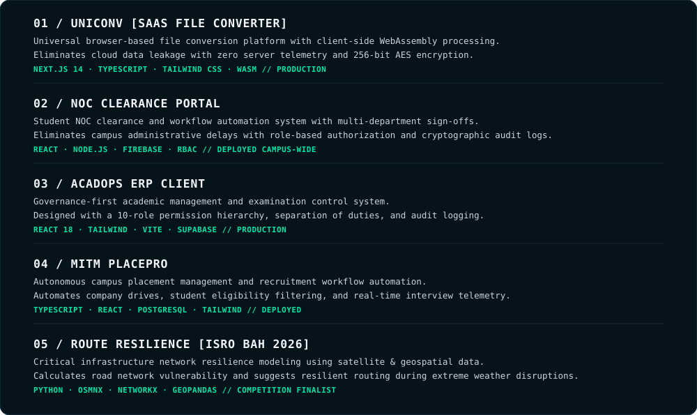
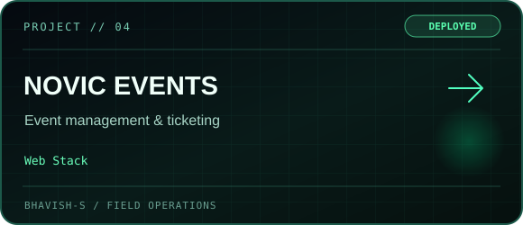
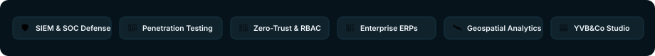
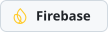
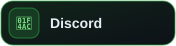

<div align="center">

<picture>
  <source media="(prefers-color-scheme: dark)" srcset="./assets/editorial/header.dark.svg" />
  
</picture>

<br/>

<a href="https://bhavish-s.github.io/Bhavish-S/"><picture><source media="(prefers-color-scheme: dark)" srcset="https://img.shields.io/badge/PORTFOLIO-07131B?style=flat-square&logo=safari&logoColor=00E5A8"/></picture></a>
<a href="https://bhavish-s.github.io/Bhavish-S/"><picture><source media="(prefers-color-scheme: dark)" srcset="https://img.shields.io/badge/%F0%9F%93%84%20RESUME-07131B?style=flat-square&logoColor=00E5A8"/></picture></a>
<a href="https://www.linkedin.com/in/bhavish-s-/"><picture><source media="(prefers-color-scheme: dark)" srcset="https://img.shields.io/badge/LINKEDIN-07131B?style=flat-square&logo=linkedin&logoColor=38BDF8"/></picture></a>
<a href="mailto:bhavishgowda2006@gmail.com"><picture><source media="(prefers-color-scheme: dark)" srcset="https://img.shields.io/badge/EMAIL-07131B?style=flat-square&logo=gmail&logoColor=00E5A8"/></picture></a>
<a href="https://www.instagram.com/bhavish.s_/"><picture><source media="(prefers-color-scheme: dark)" srcset="https://img.shields.io/badge/INSTAGRAM-07131B?style=flat-square&logo=instagram&logoColor=E1306C"/></picture></a>
<a href="https://discord.gg/QvrjjptH2a"><picture><source media="(prefers-color-scheme: dark)" srcset="https://img.shields.io/badge/DISCORD-07131B?style=flat-square&logo=discord&logoColor=5865F2"/></picture></a>
<a href="https://bhavish-s.github.io/Bhavish-S/game/"><picture><source media="(prefers-color-scheme: dark)" srcset="https://img.shields.io/badge/%F0%9F%8E%AE%20TACTICAL%20LAB-07131B?style=flat-square&logoColor=00E5A8"/></picture></a>
<a href="https://github.com/Bhavish-S"><picture><source media="(prefers-color-scheme: dark)" srcset="https://komarev.com/ghpvc/?username=Bhavish-S&style=flat-square&color=00E5A8&labelColor=07131B&label=PROFILE+VIEWS"/></picture></a>

</div>

<br/>

<!-- ══════════════════════════════════════════════════════════════════════════════
     01 // WHOAMI
     ══════════════════════════════════════════════════════════════════════════════ -->

<picture>
  <source media="(prefers-color-scheme: dark)" srcset="./assets/editorial/s01.svg" />
  
</picture>

<picture>
  <source media="(prefers-color-scheme: dark)" srcset="./assets/editorial/whoami.dark.svg" />
  
</picture>

<div align="center">
  
</div>

<br/>

<!-- ══════════════════════════════════════════════════════════════════════════════
     02 // PROJECTS
     ══════════════════════════════════════════════════════════════════════════════ -->

<picture>
  <source media="(prefers-color-scheme: dark)" srcset="./assets/editorial/s02.svg" />
  
</picture>

<picture>
  <source media="(prefers-color-scheme: dark)" srcset="./assets/editorial/projects.dark.svg" />
  
</picture>

<br/>

<table>
<tr>
<td width="50%" valign="top">
  <a href="https://github.com/Bhavish-S/noc"></a>
</td>
<td width="50%" valign="top">
  <a href="https://github.com/Bhavish-S/budget-allocator"></a>
</td>
</tr>
<tr>
<td width="50%" valign="top">
  <a href="https://github.com/Bhavish-S/Route_Resilience"></a>
</td>
<td width="50%" valign="top">
  <a href="https://github.com/Bhavish-S/Novic-Events"></a>
</td>
</tr>
<tr>
<td width="50%" valign="top">
  <a href="https://bhavish-s.github.io/Bhavish-S/game/"></a>
</td>
<td width="50%" valign="middle">

<div align="center">

### 🌱 More Repositories
Offensive security scripts, penetration testing suites, workflow automation, and cloud defense pipelines.

[**Browse all repositories →**](https://github.com/Bhavish-S?tab=repositories)

</div>

</td>
</tr>
</table>

<br/>

<!-- ══════════════════════════════════════════════════════════════════════════════
     03 // TELEMETRY (3D GRAPH AT THE TOP WITH CYBER THEME)
     ══════════════════════════════════════════════════════════════════════════════ -->

<picture>
  <source media="(prefers-color-scheme: dark)" srcset="./assets/editorial/s03.svg" />
  
</picture>

<div align="center">

<!-- TOP: LIVE 3D ISOMETRIC CONTRIBUTION CITY & STREAKS -->
<picture>
  <source media="(prefers-color-scheme: dark)" srcset="./assets/contributions.dark.svg" />
  
</picture>

<br/>

<!-- LIVE OVERVIEW SPARKLINE METRICS -->
<picture>
  <source media="(prefers-color-scheme: dark)" srcset="./assets/overview.dark.svg" />
  
</picture>

<br/>

<!-- LIVE LANGUAGE TREEMAP BREAKDOWN -->
<picture>
  <source media="(prefers-color-scheme: dark)" srcset="./assets/languages.dark.svg" />
  
</picture>

<br/>

<!-- ANIMATED CONTRIBUTION SNAKE -->
<picture>
  <source media="(prefers-color-scheme: dark)" srcset="https://raw.githubusercontent.com/Bhavish-S/Bhavish-S/output/github-contribution-grid-snake-dark.svg" />
  <source media="(prefers-color-scheme: light)" srcset="https://raw.githubusercontent.com/Bhavish-S/Bhavish-S/output/github-contribution-grid-snake.svg" />
  
</picture>

<br/><br/>

<!-- METRICS TELEMETRY BAR -->


<br/><br/>

<!-- SKILLS PROFICIENCY PROGRESS BARS -->


<br/><br/>

<!-- SPECIALIZATION FOCUS PILLS -->


</div>

<br/>

<!-- ══════════════════════════════════════════════════════════════════════════════
     04 // STACK
     ══════════════════════════════════════════════════════════════════════════════ -->

<picture>
  <source media="(prefers-color-scheme: dark)" srcset="./assets/editorial/s04.svg" />
  
</picture>

<div align="center">

<p align="center">
  <picture>
    <source media="(prefers-color-scheme: dark)" srcset="./assets/badges/burp-suite.dark.svg" />
    
  </picture>
  <picture>
    <source media="(prefers-color-scheme: dark)" srcset="./assets/badges/metasploit.dark.svg" />
    
  </picture>
  <picture>
    <source media="(prefers-color-scheme: dark)" srcset="./assets/badges/wireshark.dark.svg" />
    
  </picture>
  <picture>
    <source media="(prefers-color-scheme: dark)" srcset="./assets/badges/kalilinux.dark.svg" />
    
  </picture>
  <picture>
    <source media="(prefers-color-scheme: dark)" srcset="./assets/badges/splunk.dark.svg" />
    
  </picture>
  <picture>
    <source media="(prefers-color-scheme: dark)" srcset="./assets/badges/linux.dark.svg" />
    
  </picture>
</p>
<p align="center">
  <picture>
    <source media="(prefers-color-scheme: dark)" srcset="./assets/badges/python.dark.svg" />
    
  </picture>
  <picture>
    <source media="(prefers-color-scheme: dark)" srcset="./assets/badges/bash.dark.svg" />
    
  </picture>
  <picture>
    <source media="(prefers-color-scheme: dark)" srcset="./assets/badges/typescript.dark.svg" />
    
  </picture>
  <picture>
    <source media="(prefers-color-scheme: dark)" srcset="./assets/badges/javascript.dark.svg" />
    
  </picture>
  <picture>
    <source media="(prefers-color-scheme: dark)" srcset="./assets/badges/go.dark.svg" />
    
  </picture>
  <picture>
    <source media="(prefers-color-scheme: dark)" srcset="./assets/badges/c.dark.svg" />
    
  </picture>
</p>
<p align="center">
  <picture>
    <source media="(prefers-color-scheme: dark)" srcset="./assets/badges/docker.dark.svg" />
    
  </picture>
  <picture>
    <source media="(prefers-color-scheme: dark)" srcset="./assets/badges/kubernetes.dark.svg" />
    
  </picture>
  <picture>
    <source media="(prefers-color-scheme: dark)" srcset="./assets/badges/git.dark.svg" />
    
  </picture>
  <picture>
    <source media="(prefers-color-scheme: dark)" srcset="./assets/badges/github-actions.dark.svg" />
    
  </picture>
  <picture>
    <source media="(prefers-color-scheme: dark)" srcset="./assets/badges/firebase.dark.svg" />
    
  </picture>
  <picture>
    <source media="(prefers-color-scheme: dark)" srcset="./assets/badges/react.dark.svg" />
    
  </picture>
</p>

</div>

<sub>Badges feature official vector glyphs and render natively with instant dark and light mode support.</sub>

<br/>

<!-- ══════════════════════════════════════════════════════════════════════════════
     05 // ACHIEVEMENTS & CERTIFICATIONS
     ══════════════════════════════════════════════════════════════════════════════ -->

<picture>
  <source media="(prefers-color-scheme: dark)" srcset="./assets/editorial/s05.svg" />
  
</picture>

<div align="center">
  
  <br/><br/>
  
</div>

<br/>

<!-- ══════════════════════════════════════════════════════════════════════════════
     06 // CONNECT & FOOTER
     ══════════════════════════════════════════════════════════════════════════════ -->

<picture>
  <source media="(prefers-color-scheme: dark)" srcset="./assets/editorial/s06.svg" />
  
</picture>

<div align="center">

<p>
  <a href="https://www.instagram.com/bhavish.s_/"></a>
  <a href="https://www.linkedin.com/in/bhavish-s-/"></a>
  <a href="https://bhavish-s.github.io/Bhavish-S/"></a>
  <a href="mailto:bhavishgowda2006@gmail.com"></a>
  <a href="https://discord.gg/QvrjjptH2a"></a>
</p>



<br/><br/>
⭐️ From [@Bhavish-S](https://github.com/Bhavish-S) · **Building the future, one secure commit at a time** 🚀

</div>

---

### ⚡ Portfolio Web Application

This repository also houses the production source code for **Bhavish's Interactive Portfolio Web Application**, built with **React 19**, **Vite 8**, **Tailwind CSS v4**, **Three.js**, and **Framer Motion**.

#### Quickstart & Local Development

```bash
# Clone the repository
git clone https://github.com/Bhavish-S/Bhavish-S.git
cd Bhavish-S

# Install dependencies
npm install

# Start local development server
npm run dev

# Typecheck and build for production
npm run build
```
