

<!-- ══════════════════════════════════════════════════════════════════════════════
     BHAVISH S — CYBERSECURITY COMMAND CENTER & PORTFOLIO
     Unified Quantum Cyber Architecture • 100% Dark Matrix Theme
     ══════════════════════════════════════════════════════════════════════════════ -->

  <!-- 01 // HERO DIGITAL COMMAND CENTER -->
  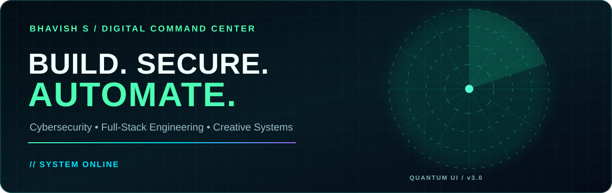
  
  <!-- 02 // OPERATOR FOCUS TIERS -->
  

  <!-- DYNAMIC TERMINAL PROMPT (HARDENED WITH DARK BACKGROUND) -->
  
    

  <!-- QUICK NAVIGATION HUD -->
  

    <code><a href="#dossier">DOSSIER</a></code> &nbsp;•&nbsp;
    <code><a href="#pipeline">DEVSECOPS</a></code> &nbsp;•&nbsp;
    <code><a href="#projects">FIELD OPS</a></code> &nbsp;•&nbsp;
    <code><a href="#missions">MISSIONS</a></code> &nbsp;•&nbsp;
    <code><a href="#arsenal">ARSENAL</a></code> &nbsp;•&nbsp;
    <code><a href="#telemetry">TELEMETRY</a></code> &nbsp;•&nbsp;
    <code><a href="#matrix">MITRE MATRIX</a></code> &nbsp;•&nbsp;
    <code><a href="#game">TACTICAL LAB</a></code> &nbsp;•&nbsp;
    <code><a href="#connect">CONNECT</a></code>
  

  <!-- TRANSMISSION PILLS -->
  
  
  
  
  <a href="https://twitter.com">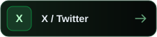</a>
  
  
    

  <!-- LIVE TELEMETRY BADGES -->
  
  
  
    

  <!-- 03 // NETWORK TOPOLOGY -->
  

 

<!-- ═══════════════════ 01 // THREAT DOSSIER ═══════════════════ -->

  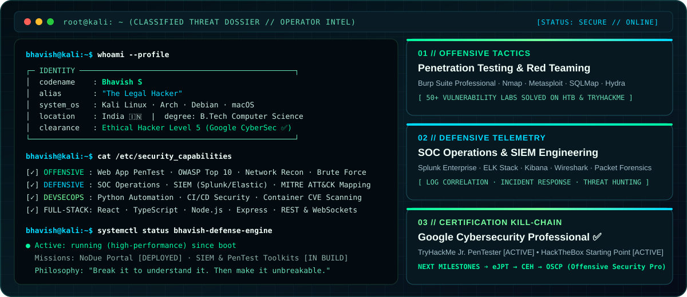

 

<!-- ═══════════════════ 02 // SECURE SDLC & DEVSECOPS PIPELINE ═══════════════════ -->

  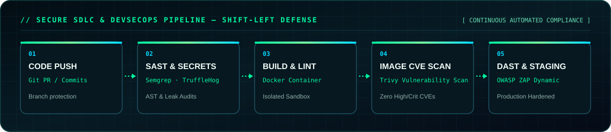

 

<!-- ═══════════════════ 03 // FIELD OPS (PROJECTS) ═══════════════════ -->

  <table>
    <tr>
      <td width="50%" valign="top">
        <a href="https://github.com/Bhavish-S/noc">
          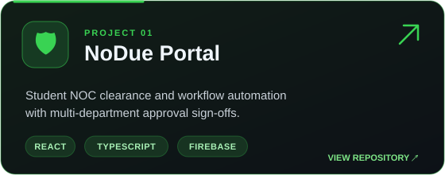
        </a>
      </td>
      <td width="50%" valign="top">
        
      </td>
    </tr>
    <tr>
      <td width="50%" valign="top">
        
      </td>
      <td width="50%" valign="top">
        
      </td>
    </tr>
    <tr>
      <td width="50%" valign="top">
        
      </td>
      <td width="50%" valign="top">
        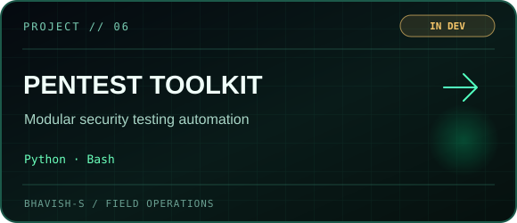
      </td>
    </tr>
  </table>

 

<!-- ═══════════════════ 04 // ACTIVE OPERATIONS ═══════════════════ -->

  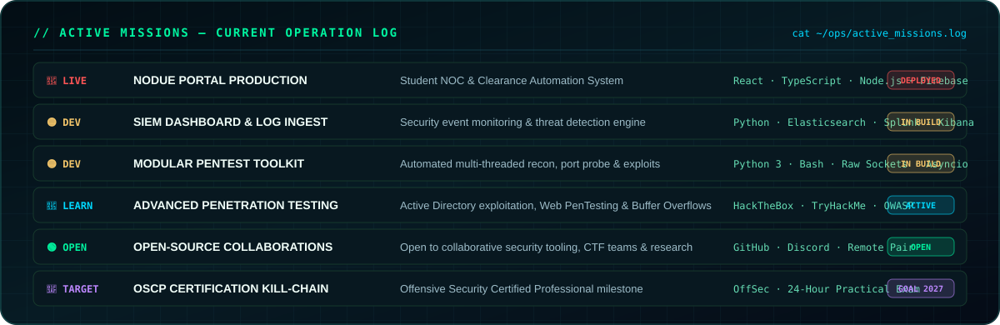

 

<!-- ═══════════════════ 05 // WEAPON SYSTEMS ARSENAL ═══════════════════ -->

  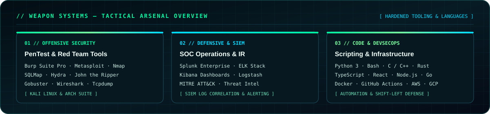
    

  <!-- SKILL ICONS (DARK CYBER MATRIX) -->
  
    
  
  <!-- LOCAL SECURITY BADGES (OBSIDIAN DARK) -->
  <picture><source media="(prefers-color-scheme: dark)" srcset="./assets/badges/burp-suite.dark.svg"/>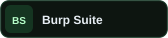</picture>
  <picture><source media="(prefers-color-scheme: dark)" srcset="./assets/badges/metasploit.dark.svg"/></picture>
  <picture><source media="(prefers-color-scheme: dark)" srcset="./assets/badges/nmap.dark.svg"/></picture>
  <picture><source media="(prefers-color-scheme: dark)" srcset="./assets/badges/sqlmap.dark.svg"/>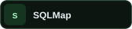</picture>
  <picture><source media="(prefers-color-scheme: dark)" srcset="./assets/badges/hydra.dark.svg"/></picture>
  <picture><source media="(prefers-color-scheme: dark)" srcset="./assets/badges/john-the-ripper.dark.svg"/>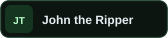</picture>
  <picture><source media="(prefers-color-scheme: dark)" srcset="./assets/badges/gobuster.dark.svg"/></picture>
  <picture><source media="(prefers-color-scheme: dark)" srcset="./assets/badges/splunk.dark.svg"/>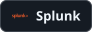</picture>
  <picture><source media="(prefers-color-scheme: dark)" srcset="./assets/badges/elk.dark.svg"/></picture>
  <picture><source media="(prefers-color-scheme: dark)" srcset="./assets/badges/kibana.dark.svg"/></picture>
  <picture><source media="(prefers-color-scheme: dark)" srcset="./assets/badges/siem.dark.svg"/>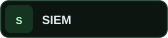</picture>
  <picture><source media="(prefers-color-scheme: dark)" srcset="./assets/badges/mitre-att-ck.dark.svg"/>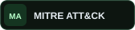</picture>
  <picture><source media="(prefers-color-scheme: dark)" srcset="./assets/badges/threat-intel.dark.svg"/>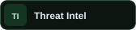</picture>
  <picture><source media="(prefers-color-scheme: dark)" srcset="./assets/badges/devsecops.dark.svg"/></picture>
  <picture><source media="(prefers-color-scheme: dark)" srcset="./assets/badges/ctf.dark.svg"/>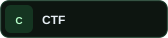</picture>
    

  <!-- INFRASTRUCTURE & FULL STACK (DARK CYBER MATRIX) -->
  

 

<!-- ═══════════════════ 06 // LIVE TELEMETRY & INTEL ═══════════════════ -->

  <!-- LIVE CONTRIBUTION HEATMAP -->
  

    

  <!-- GITHUB INTEL & STREAK MATRIX (UNIFIED #05090F) -->
  <table width="100%">
    <tr>
      <td width="50%" align="center" valign="middle">
        
      </td>
      <td width="50%" align="center" valign="middle">
        
      </td>
    </tr>
    <tr>
      <td width="50%" align="center" valign="middle">
        
      </td>
      <td width="50%" align="center" valign="middle">
        
      </td>
    </tr>
  </table>

   

  <!-- ANIMATED CONTRIBUTION GRID SNAKE -->
  <picture>
    <source media="(prefers-color-scheme: dark)" srcset="https://raw.githubusercontent.com/Bhavish-S/Bhavish-S/output/github-contribution-grid-snake-dark.svg" />
    <source media="(prefers-color-scheme: light)" srcset="https://raw.githubusercontent.com/Bhavish-S/Bhavish-S/output/github-contribution-grid-snake.svg" />
    
  </picture>

 

<!-- ═══════════════════ 07 // MITRE ATT&CK MATRIX ═══════════════════ -->

  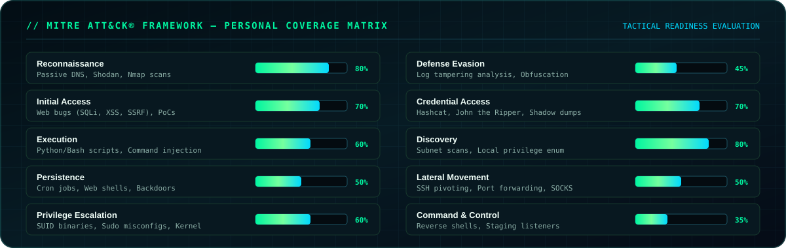

 

<!-- ═══════════════════ 08 // TACTICAL LAB (BROWSER GAME) ═══════════════════ -->

  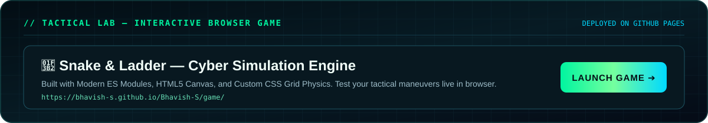

 

<!-- ═══════════════════ 09 // SECURE CHANNEL HANDSHAKE ═══════════════════ -->

  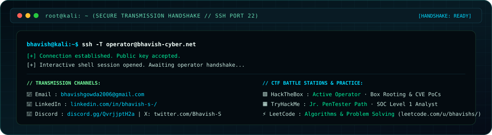

 

<!-- ═══════════════════ 10 // FOOTER & END OF TRANSMISSION ═══════════════════ -->

  
   
  Crafted with precision, 🔐, and terminal coffee by <b>Bhavish S</b>
   
  🌐 <b>Hack the Planet — Legally.</b> | ⭐ Drop a star if this profile inspired you!

<!-- ══════════════════════════════════════════════════════════════════════════════
     CTF CHALLENGE: RECON OPERATOR TEST
     Stage 1 (Binary): 01000010 01101000 01100001 01110110 01101001 01110011 01101000 00100000 01010011
     Stage 2 (Hex)   : 54 68 65 20 4c 65 67 61 6c 20 48 61 63 6b 65 72
     Stage 3 (Base64): ZmxhZ3tZb3VfQXJlX0FfVHJ1ZV9DeWJlcl9PcGVyYXRvcn0=
     Decoded the flag? DM me on LinkedIn with the solution!
     ══════════════════════════════════════════════════════════════════════════════ -->
