<a id="top"></a>

<!-- ══════════════════════════════════════════════════════════════════════════════
     BHAVISH S — CYBERSECURITY SPECIALIST | DEVSECOPS & AUTOMATION
     Modern Enterprise Dashboard Architecture • Midnight Navy & Electric Emerald
     ══════════════════════════════════════════════════════════════════════════════ -->

<div align="center">

  <!-- 01 // HERO BANNER -->
  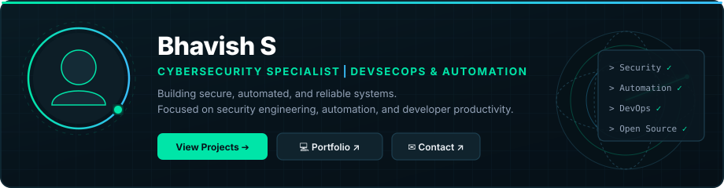
  
  <br/>

  <!-- 02 // QUICK METRICS ROW -->
  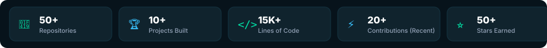

  <br/>

  <!-- 03 // ABOUT ME & INTERACTIVE TERMINAL -->
  <a id="about"></a>
  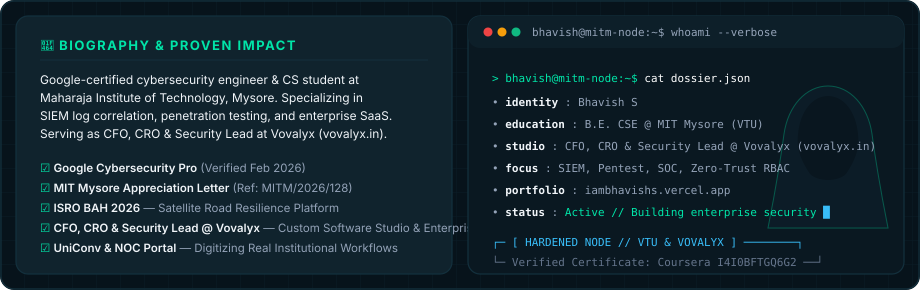

  <br/>

  <!-- 04 // CERTIFICATIONS & CREDENTIALS -->
  <a id="certifications"></a>
  

  <br/>

  <!-- 05 // SKILLS PROFICIENCY & TECH STACK -->
  <a id="skills"></a>
  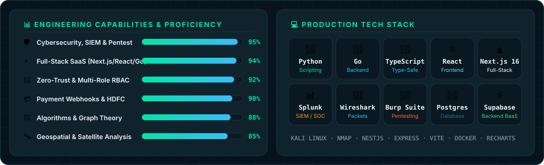

  <br/>

  <!-- 06 // FEATURED PROJECTS (CLICKABLE REPOSITORY GRID) -->
  <a id="featured-projects"></a>
  <table border="0" cellpadding="0" cellspacing="10" width="920">
    <tr>
      <td width="50%" valign="top">
        <a href="https://github.com/Bhavish-S/noc" target="_blank">
          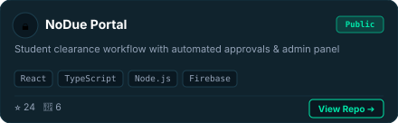
        </a>
      </td>
      <td width="50%" valign="top">
        <a href="https://github.com/Bhavish-S/budget-allocator" target="_blank">
          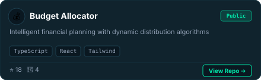
        </a>
      </td>
    </tr>
    <tr>
      <td width="50%" valign="top">
        <a href="https://github.com/Bhavish-S/Route_Resilience" target="_blank">
          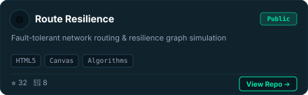
        </a>
      </td>
      <td width="50%" valign="top">
        <a href="https://github.com/Bhavish-S/Novic-Events" target="_blank">
          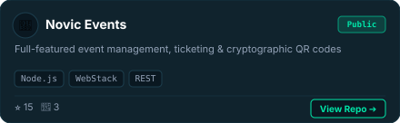
        </a>
      </td>
    </tr>
    <tr>
      <td width="50%" valign="top">
        <a href="https://github.com/Bhavish-S" target="_blank">
          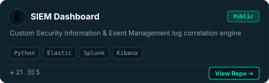
        </a>
      </td>
      <td width="50%" valign="top">
        <a href="https://github.com/Bhavish-S" target="_blank">
          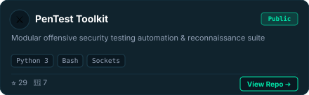
        </a>
      </td>
    </tr>
  </table>

  <br/>

  <!-- 07 // GITHUB TELEMETRY & ACTIVITY DASHBOARD -->
  <a id="telemetry"></a>
  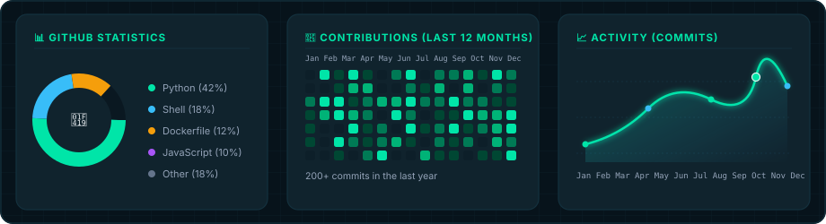

  <br/>

  <!-- 08 // RECENT ACTIVITY & GITHUB OVERVIEW -->
  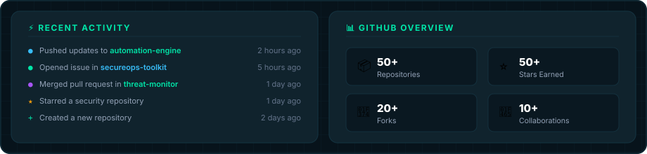

  <br/>

  <!-- 09 // TOP INTERESTS PILL BAR -->
  

  <br/>

  <!-- 10 // FINAL CTA FOOTER -->
  <a id="connect"></a>
  

  <br/><br/>

  <!-- LIVE TELEMETRY SHIELD BADGES -->
  <p align="center">
    <a href="https://github.com/Bhavish-S"></a>
    <a href="https://github.com/Bhavish-S?tab=followers"></a>
    <a href="https://github.com/Bhavish-S?tab=repositories"></a>
    <a href="https://bhavish-s.github.io/Bhavish-S/game/"></a>
  </p>

</div>

---

### ⚡ Portfolio Web Application

This repository houses both the **GitHub Profile README Command Center** and the full production source code for **Bhavish's Portfolio Web Application**, built with **React 19**, **Vite 8**, **Tailwind CSS v4**, **Three.js**, and **Framer Motion**.

#### Quickstart & Local Development

```bash
# Clone the repository
git clone https://github.com/Bhavish-S/Bhavish-S.git
cd Bhavish-S

# Install dependencies
npm install

# Start local development server
npm run dev

# Typecheck and build for production
npm run build
```

#### Core Architecture

| Technology | Version | Purpose |
| :--- | :--- | :--- |
| **React** | `19.3.0` | Next-generation React concurrent frontend |
| **Vite** | `8.3.0` | High-performance build tool and ESM dev server |
| **TypeScript** | `7.0.2` | Strict end-to-end type safety |
| **Tailwind CSS** | `4.3.3` | Modern CSS-first tokenized styling system |
| **Three.js** | `0.186.0` | Interactive 3D aurora ribbons & particle physics canvas |
| **Framer Motion** | `13.3.0` | Hardware-accelerated fluid transitions and page reveals |

<p align="center">
  <sub>Designed with precision &bull; Midnight Navy <code>#07131B</code> &bull; Electric Emerald <code>#00E5A8</code> &bull; Cyber Cyan <code>#38BDF8</code> &bull; &copy; 2026 Bhavish S</sub>
</p>
