

<!-- ══════════════════════════════════════════════════════════════════════════════
     00 // HERO HEADER & DYNAMIC COMMAND CENTER
     ══════════════════════════════════════════════════════════════════════════════ -->

<picture>
  <source media="(prefers-color-scheme: dark)" srcset="./assets/editorial/header.dark.svg" />
  
</picture>

 

<!-- DYNAMIC TYPING TAGLINE -->

 

<!-- TOP QUICK-ACTION PILLS -->

  <a href="https://iambhavishs.vercel.app/"><picture><source media="(prefers-color-scheme: dark)" srcset="https://img.shields.io/badge/%F0%9F%8C%90%20PORTFOLIO-07131B?style=flat-square&logo=safari&logoColor=00E5A8"/></picture></a>
  &nbsp;
  <a href="https://iambhavishs.vercel.app/assets/Bhavish_S_Resume.pdf"><picture><source media="(prefers-color-scheme: dark)" srcset="https://img.shields.io/badge/%F0%9F%93%84%20RESUME-07131B?style=flat-square&logoColor=00E5A8"/></picture></a>
  &nbsp;
  <a href="https://bhavish-s.github.io/Bhavish-S/game/"><picture><source media="(prefers-color-scheme: dark)" srcset="https://img.shields.io/badge/%F0%9F%8E%B2%20PLAY%20SNAKE%20%26%20LADDER-07131B?style=flat-square&logoColor=00E5A8"/></picture></a>
  &nbsp;
  <a href="https://yvb-co.vercel.app/"><picture><source media="(prefers-color-scheme: dark)" srcset="https://img.shields.io/badge/%F0%9F%8F%A2%20STUDIO-07131B?style=flat-square&logo=vercel&logoColor=F59E0B"/></picture></a>
  &nbsp;
  <a href="https://www.linkedin.com/in/bhavish-s-/"><picture><source media="(prefers-color-scheme: dark)" srcset="https://img.shields.io/badge/LINKEDIN-07131B?style=flat-square&logo=linkedin&logoColor=38BDF8"/></picture></a>
  &nbsp;
  <a href="mailto:x.bhavish.s@gmail.com"><picture><source media="(prefers-color-scheme: dark)" srcset="https://img.shields.io/badge/EMAIL-07131B?style=flat-square&logo=gmail&logoColor=00E5A8"/></picture></a>
  &nbsp;
  <a href="https://github.com/Bhavish-S"><picture><source media="(prefers-color-scheme: dark)" srcset="https://komarev.com/ghpvc/?username=Bhavish-S&style=flat-square&color=00E5A8&labelColor=07131B&label=PROFILE+VIEWS"/></picture></a>

 

<!-- ══════════════════════════════════════════════════════════════════════════════
     01 // WHOAMI & EXECUTIVE DOSSIER
     ══════════════════════════════════════════════════════════════════════════════ -->

<picture>
  <source media="(prefers-color-scheme: dark)" srcset="./assets/editorial/s01.dark.svg" />
  
</picture>

> **Bhavish S** is a Google-certified Cybersecurity Specialist, Full-Stack Systems Architect, and Computer Science & Engineering scholar at **Maharaja Institute of Technology, Mysore** (2023–2027). He serves as **CFO & CRO at YVB&Co**, an independent software engineering studio.
> 
> - 🛡️ **Defensive & Offensive Core**: SIEM log analytics, SOC incident triage, automated penetration testing, Zero-Trust RBAC.
> - 🚀 **Engineering Impact**: Architected and deployed campus-adopted ERP platforms recognized with an **Official Letter of Appreciation from the MITM Principal**, and placed as a finalist in the **ISRO Bharatiya Antariksh Hackathon 2026**.
> - ⚡ **Production Deployments**: 10+ live platforms serving active institutional users across Mysore and Karnataka.

  <picture>
    <source media="(prefers-color-scheme: dark)" srcset="./assets/dashboard/about-terminal.dark.svg" />
    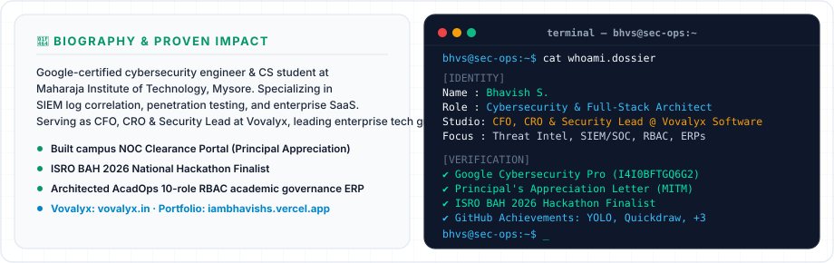
  </picture>

 

<!-- ══════════════════════════════════════════════════════════════════════════════
     02 // THE DIGITAL LAB · ARCADE & CONTRIBUTION SNAKE
     ══════════════════════════════════════════════════════════════════════════════ -->

<picture>
  <source media="(prefers-color-scheme: dark)" srcset="./assets/editorial/s02.dark.svg" />
  
</picture>

<!-- RETRO-MODERN SNAKE & LADDER GAME BANNER -->
<a href="https://bhavish-s.github.io/Bhavish-S/game/" target="_blank" rel="noopener noreferrer">
  <picture>
    <source media="(prefers-color-scheme: dark)" srcset="./assets/dashboard/snake-ladder-banner.dark.svg" />
    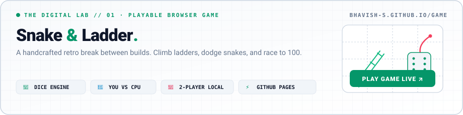
  </picture>
</a>

 

  <a href="https://bhavish-s.github.io/Bhavish-S/game/" target="_blank" rel="noopener noreferrer">
    <picture>
      <source media="(prefers-color-scheme: dark)" srcset="https://img.shields.io/badge/%E2%96%B6%EF%B8%8F%20PLAY%20NOW-bhavish--s.github.io%2Fgame-00E5A8?style=for-the-badge&logoColor=07131B&labelColor=07131B" />
      
    </picture>
  </a>

🎲 <b>Snake & Ladder</b> is a handcrafted browser game living right in this repository. Play against the computer AI or pass-and-play with a friend on the same device!

  

<!-- ANIMATED CONTRIBUTION SNAKE -->
<picture>
  <source media="(prefers-color-scheme: dark)" srcset="https://raw.githubusercontent.com/Bhavish-S/Bhavish-S/output/github-contribution-grid-snake-dark.svg" />
  <source media="(prefers-color-scheme: light)" srcset="https://raw.githubusercontent.com/Bhavish-S/Bhavish-S/output/github-contribution-grid-snake.svg" />
  
</picture>

🐍 <b>Contribution Snake:</b> Eating commits in real-time across the GitHub activity matrix.

 

<!-- ══════════════════════════════════════════════════════════════════════════════
     03 // VENTURE STUDIO & FLAGSHIP SYSTEMS
     ══════════════════════════════════════════════════════════════════════════════ -->

<picture>
  <source media="(prefers-color-scheme: dark)" srcset="./assets/editorial/s03.dark.svg" />
  
</picture>

  <a href="https://yvb-co.vercel.app/" target="_blank" rel="noopener noreferrer">
    <picture>
      <source media="(prefers-color-scheme: dark)" srcset="./assets/dashboard/studio-yvb.dark.svg" />
      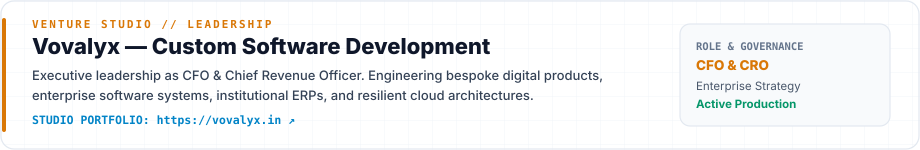
    </picture>
  </a>

 

<picture>
  <source media="(prefers-color-scheme: dark)" srcset="./assets/editorial/projects.dark.svg" />
  
</picture>

 

<table>
<tr>
<td width="50%" valign="top">
  <a href="https://uniconv-psi.vercel.app/" target="_blank" rel="noopener noreferrer">
    <picture>
      <source media="(prefers-color-scheme: dark)" srcset="./assets/project-uniconv.dark.svg" />
      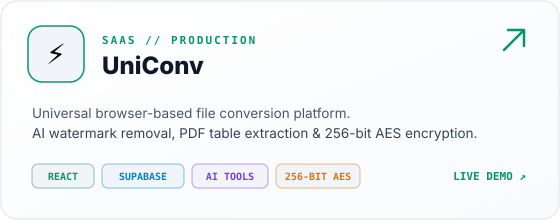
    </picture>
  </a>
   
  <b>⚡ <a href="https://uniconv-psi.vercel.app/">UniConv (SaaS)</a></b> · <code>Production</code> 
  Universal client-side converter with 256-bit AES encryption & AI watermark removal.
</td>
<td width="50%" valign="top">
  <a href="https://noc-portal-self.vercel.app/" target="_blank" rel="noopener noreferrer">
    <picture>
      <source media="(prefers-color-scheme: dark)" srcset="./assets/project-nodue-portal.dark.svg" />
      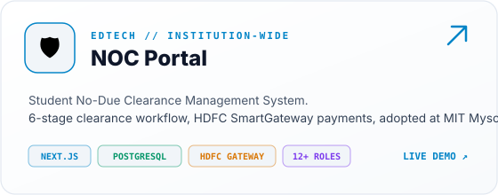
    </picture>
  </a>
   
  <b>🎓 <a href="https://noc-portal-self.vercel.app/">NOC Portal</a></b> · <code>Institutional</code> 
  Campus-wide digital student clearance system replacing physical paper signatures at MITM.
</td>
</tr>
<tr>
<td width="50%" valign="top">
  <a href="https://erp-client-9lbk.vercel.app/" target="_blank" rel="noopener noreferrer">
    <picture>
      <source media="(prefers-color-scheme: dark)" srcset="./assets/project-erp-client.dark.svg" />
      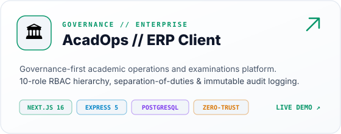
    </picture>
  </a>
   
  <b>🏛️ <a href="https://erp-client-9lbk.vercel.app/">AcadOps ERP</a></b> · <code>Enterprise</code> 
  Academic governance suite with fine-grained RBAC, workload modeling & policy tracking.
</td>
<td width="50%" valign="top">
  <a href="https://mitm-placepro.vercel.app/" target="_blank" rel="noopener noreferrer">
    <picture>
      <source media="(prefers-color-scheme: dark)" srcset="./assets/project-placepro.dark.svg" />
      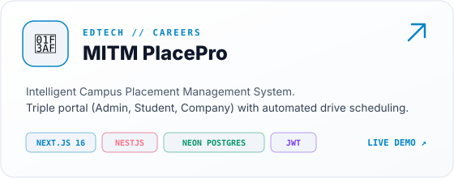
    </picture>
  </a>
   
  <b>💼 <a href="https://mitm-placepro.vercel.app/">MITM PlacePro</a></b> · <code>Production</code> 
  Automated campus placement drive management, student eligibility filtering & company metrics.
</td>
</tr>
<tr>
<td width="50%" valign="top">
  <a href="https://mitm-rd.vercel.app/" target="_blank" rel="noopener noreferrer">
    <picture>
      <source media="(prefers-color-scheme: dark)" srcset="./assets/project-jnanashodha.dark.svg" />
      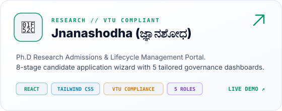
    </picture>
  </a>
   
  <b>🔬 <a href="https://mitm-rd.vercel.app/">Jnanashodha</a></b> · <code>Institutional</code> 
  VTU-affiliated research admissions, candidate tracking & doctoral lifecycle governance.
</td>
<td width="50%" valign="top">
  <a href="https://github.com/Bhavish-S/Route_Resilience" target="_blank" rel="noopener noreferrer">
    <picture>
      <source media="(prefers-color-scheme: dark)" srcset="./assets/project-route-resilience.dark.svg" />
      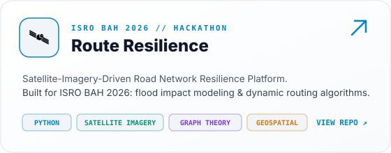
    </picture>
  </a>
   
  <b>🛰️ <a href="https://github.com/Bhavish-S/Route_Resilience">Route Resilience</a></b> · <code>ISRO BAH Finalist</code> 
  Satellite-derived road network flood resilience & emergency evacuation graph simulation.
</td>
</tr>
</table>

All systems running in active production or institutional deployment. Explore full architectures at <a href="https://iambhavishs.vercel.app/">iambhavishs.vercel.app</a>.

 

<!-- ══════════════════════════════════════════════════════════════════════════════
     04 // THE ROUTE // VERIFIED MILESTONES
     ══════════════════════════════════════════════════════════════════════════════ -->

<picture>
  <source media="(prefers-color-scheme: dark)" srcset="./assets/editorial/s04.dark.svg" />
  
</picture>

<picture>
  <source media="(prefers-color-scheme: dark)" srcset="./assets/editorial/timeline.dark.svg" />
  
</picture>

> **The Engineering Path at a Glance:**
> - **2022 · First Commit**: Built core foundations in Linux systems programming, Python automation, and low-level networking.
> - **2023 · B.E. CSE @ MIT Mysore**: Initiated formal computer science degree; began offensive cyber research and SIEM architecture.
> - **2024 · SOC Operations & PenTesting**: Automated vulnerability assessments, security logging, and hands-on CTF reverse engineering.
> - **2025 · Studio Leadership @ YVB&Co**: Co-founded software studio; built UniConv, MITM PlacePro, AcadOps ERP, and NOC Portal.
> - **2026 · Institutional Honors**: Verified as Google Cybersecurity Professional, honored with MIT Mysore Principal's Letter of Appreciation, and named Finalist in ISRO Bharatiya Antariksh Hackathon.

 

<!-- ══════════════════════════════════════════════════════════════════════════════
     05 // TELEMETRY & LIVE PERFORMANCE MATRIX
     ══════════════════════════════════════════════════════════════════════════════ -->

<picture>
  <source media="(prefers-color-scheme: dark)" srcset="./assets/editorial/s05.dark.svg" />
  
</picture>

<!-- 3D ISOMETRIC CONTRIBUTION CITY -->
<picture>
  <source media="(prefers-color-scheme: dark)" srcset="./assets/contributions.dark.svg" />
  
</picture>

 

<!-- LIVE OVERVIEW METRICS -->
<picture>
  <source media="(prefers-color-scheme: dark)" srcset="./assets/overview.dark.svg" />
  
</picture>

 

<!-- LANGUAGE TREEMAP BREAKDOWN -->
<picture>
  <source media="(prefers-color-scheme: dark)" srcset="./assets/languages.dark.svg" />
  
</picture>

 

<!-- TELEMETRY METRICS BAR -->
<picture>
  <source media="(prefers-color-scheme: dark)" srcset="./assets/dashboard/stats-bar.dark.svg" />
  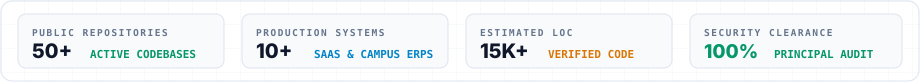
</picture>

 

<!-- ══════════════════════════════════════════════════════════════════════════════
     06 // TECHNICAL ARSENAL // PRODUCTION STACK
     ══════════════════════════════════════════════════════════════════════════════ -->

<picture>
  <source media="(prefers-color-scheme: dark)" srcset="./assets/editorial/s06.dark.svg" />
  
</picture>

<!-- Row 1: Offensive Security & SOC -->

  <b>🛡️ OFFENSIVE SECURITY &amp; SOC DEFENSE</b> 
  <picture><source media="(prefers-color-scheme: dark)" srcset="./assets/badges/burp-suite.dark.svg" /></picture>
  <picture><source media="(prefers-color-scheme: dark)" srcset="./assets/badges/metasploit.dark.svg" /></picture>
  <picture><source media="(prefers-color-scheme: dark)" srcset="./assets/badges/wireshark.dark.svg" /></picture>
  <picture><source media="(prefers-color-scheme: dark)" srcset="./assets/badges/kalilinux.dark.svg" /></picture>
  <picture><source media="(prefers-color-scheme: dark)" srcset="./assets/badges/splunk.dark.svg" /></picture>
  <picture><source media="(prefers-color-scheme: dark)" srcset="./assets/badges/nmap.dark.svg" /></picture>

<!-- Row 2: Modern Web & Full-Stack -->

  <b>⚡ FULL-STACK SYSTEMS &amp; FRAMEWORKS</b> 
  <picture><source media="(prefers-color-scheme: dark)" srcset="./assets/badges/react.dark.svg" /></picture>
  <picture><source media="(prefers-color-scheme: dark)" srcset="./assets/badges/next-js.dark.svg" /></picture>
  <picture><source media="(prefers-color-scheme: dark)" srcset="./assets/badges/express.dark.svg" /></picture>
  <picture><source media="(prefers-color-scheme: dark)" srcset="./assets/badges/tailwind.dark.svg" /></picture>
  <picture><source media="(prefers-color-scheme: dark)" srcset="./assets/badges/vite.dark.svg" /></picture>

<!-- Row 3: Languages & Scripting -->

  <b>⚙️ CORE LANGUAGES &amp; SYSTEMS</b> 
  <picture><source media="(prefers-color-scheme: dark)" srcset="./assets/badges/python.dark.svg" /></picture>
  <picture><source media="(prefers-color-scheme: dark)" srcset="./assets/badges/go.dark.svg" /></picture>
  <picture><source media="(prefers-color-scheme: dark)" srcset="./assets/badges/typescript.dark.svg" /></picture>
  <picture><source media="(prefers-color-scheme: dark)" srcset="./assets/badges/javascript.dark.svg" /></picture>
  <picture><source media="(prefers-color-scheme: dark)" srcset="./assets/badges/bash.dark.svg" /></picture>
  <picture><source media="(prefers-color-scheme: dark)" srcset="./assets/badges/linux.dark.svg" /></picture>

<!-- Row 4: Cloud, Databases & DevOps -->

  <b>☁️ CLOUD, DATABASES &amp; DEVOPS</b> 
  <picture><source media="(prefers-color-scheme: dark)" srcset="./assets/badges/postgresql.dark.svg" /></picture>
  <picture><source media="(prefers-color-scheme: dark)" srcset="./assets/badges/supabase.dark.svg" /></picture>
  <picture><source media="(prefers-color-scheme: dark)" srcset="./assets/badges/vercel.dark.svg" /></picture>
  <picture><source media="(prefers-color-scheme: dark)" srcset="./assets/badges/docker.dark.svg" /></picture>
  <picture><source media="(prefers-color-scheme: dark)" srcset="./assets/badges/git.dark.svg" /></picture>
  <picture><source media="(prefers-color-scheme: dark)" srcset="./assets/badges/github-actions.dark.svg" /></picture>

 

<!-- ══════════════════════════════════════════════════════════════════════════════
     07 // VERIFIED CREDENTIALS & SECURE CONNECT
     ══════════════════════════════════════════════════════════════════════════════ -->

<picture>
  <source media="(prefers-color-scheme: dark)" srcset="./assets/editorial/s07.dark.svg" />
  
</picture>

  <!-- INSTITUTIONAL CERTIFICATIONS CARD -->
  <picture>
    <source media="(prefers-color-scheme: dark)" srcset="./assets/dashboard/certifications.dark.svg" />
    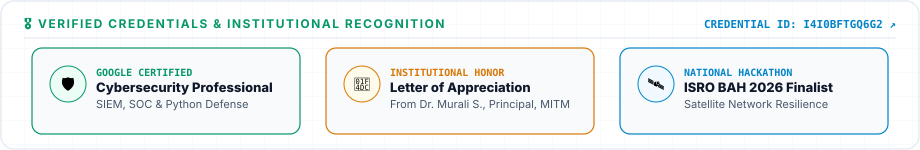
  </picture>
  
    

  <!-- OFFICIAL GITHUB BADGES -->
  

    
    &nbsp;&nbsp;
    
    &nbsp;&nbsp;
    
    &nbsp;&nbsp;
    
    &nbsp;&nbsp;
    
  

   

  <picture>
    <source media="(prefers-color-scheme: dark)" srcset="./assets/dashboard/achievements.dark.svg" />
    
  </picture>

    

  <!-- SOCIAL LINK BUTTONS -->
  

    
    
    
    
    
    
  

  <picture>
    <source media="(prefers-color-scheme: dark)" srcset="./assets/profile-footer.dark.svg" />
    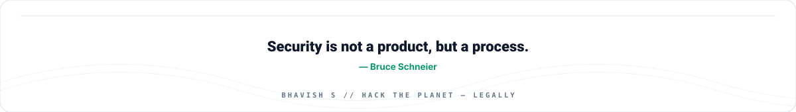
  </picture>

    
  ⭐️ From [@Bhavish-S](https://github.com/Bhavish-S) · **Building the future, one secure commit at a time** 🚀

---

### ⚡ Portfolio Web Application

This repository also houses the production source code for **Bhavish's Interactive Portfolio Web Application**, live at **[iambhavishs.vercel.app](https://iambhavishs.vercel.app/)**, built with **React 19**, **Vite 8**, **Tailwind CSS v4**, and **Framer Motion**.
