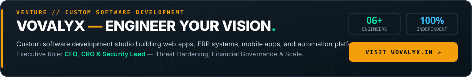
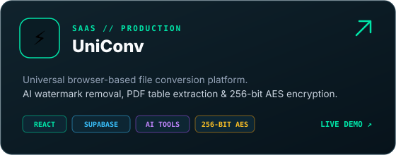
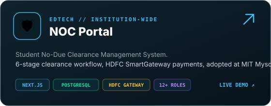
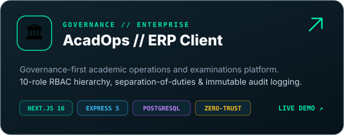
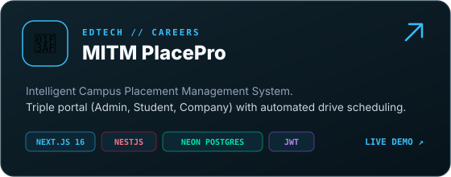
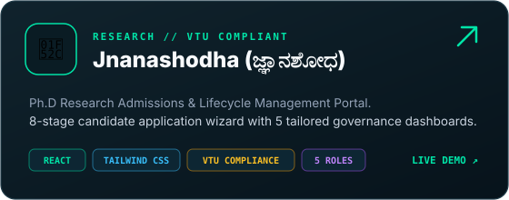
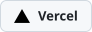
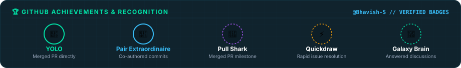
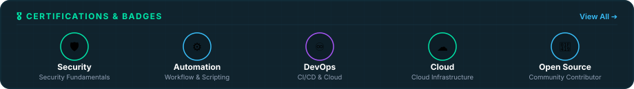

<picture>
  <source media="(prefers-color-scheme: dark)" srcset="./assets/editorial/header.dark.svg" />
  
</picture>

 

<a href="https://iambhavishs.vercel.app/"><picture><source media="(prefers-color-scheme: dark)" srcset="https://img.shields.io/badge/PORTFOLIO-07131B?style=flat-square&logo=safari&logoColor=00E5A8"/></picture></a>
<a href="https://iambhavishs.vercel.app/assets/Bhavish_S_Resume.pdf"><picture><source media="(prefers-color-scheme: dark)" srcset="https://img.shields.io/badge/%F0%9F%93%84%20RESUME-07131B?style=flat-square&logoColor=00E5A8"/></picture></a>
<a href="https://yvb-co.vercel.app/"><picture><source media="(prefers-color-scheme: dark)" srcset="https://img.shields.io/badge/STUDIO-07131B?style=flat-square&logo=vercel&logoColor=F59E0B"/></picture></a>
<a href="https://www.linkedin.com/in/bhavish-s-/"><picture><source media="(prefers-color-scheme: dark)" srcset="https://img.shields.io/badge/LINKEDIN-07131B?style=flat-square&logo=linkedin&logoColor=38BDF8"/></picture></a>
<a href="mailto:x.bhavish.s@gmail.com"><picture><source media="(prefers-color-scheme: dark)" srcset="https://img.shields.io/badge/EMAIL-07131B?style=flat-square&logo=gmail&logoColor=00E5A8"/></picture></a>
<a href="https://www.instagram.com/bhavish_s_/"><picture><source media="(prefers-color-scheme: dark)" srcset="https://img.shields.io/badge/INSTAGRAM-07131B?style=flat-square&logo=instagram&logoColor=E1306C"/></picture></a>
<a href="https://github.com/Bhavish-S"><picture><source media="(prefers-color-scheme: dark)" srcset="https://komarev.com/ghpvc/?username=Bhavish-S&style=flat-square&color=00E5A8&labelColor=07131B&label=PROFILE+VIEWS"/></picture></a>

 

<!-- ══════════════════════════════════════════════════════════════════════════════
     01 // WHOAMI & EXECUTIVE DOSSIER
     ══════════════════════════════════════════════════════════════════════════════ -->

<picture>
  <source media="(prefers-color-scheme: dark)" srcset="./assets/editorial/s01.svg" />
  
</picture>

  

 

<!-- ══════════════════════════════════════════════════════════════════════════════
     02 // VENTURE STUDIO & PRODUCTION SYSTEMS
     ══════════════════════════════════════════════════════════════════════════════ -->

<picture>
  <source media="(prefers-color-scheme: dark)" srcset="./assets/editorial/s02.svg" />
  
</picture>

  

 

<table>
<tr>
<td width="50%" valign="top">
  
</td>
<td width="50%" valign="top">
  
</td>
</tr>
<tr>
<td width="50%" valign="top">
  
</td>
<td width="50%" valign="top">
  
</td>
</tr>
<tr>
<td width="50%" valign="top">
  
</td>
<td width="50%" valign="top">
  
</td>
</tr>
</table>

All projects deployed in production or active institutional operation. Visit <a href="https://iambhavishs.vercel.app/">iambhavishs.vercel.app</a> for architecture breakdowns.

 

<!-- ══════════════════════════════════════════════════════════════════════════════
     04 // TELEMETRY & LIVE ACTIVITY (3D CITY GRAPH AT TOP)
     ══════════════════════════════════════════════════════════════════════════════ -->

<picture>
  <source media="(prefers-color-scheme: dark)" srcset="./assets/editorial/s03.svg" />
  
</picture>

<!-- TOP: LIVE 3D ISOMETRIC CONTRIBUTION CITY & STREAKS -->
<picture>
  <source media="(prefers-color-scheme: dark)" srcset="./assets/contributions.dark.svg" />
  
</picture>

 

<!-- LIVE OVERVIEW SPARKLINE METRICS -->
<picture>
  <source media="(prefers-color-scheme: dark)" srcset="./assets/overview.dark.svg" />
  
</picture>

 

<!-- LIVE LANGUAGE TREEMAP BREAKDOWN -->
<picture>
  <source media="(prefers-color-scheme: dark)" srcset="./assets/languages.dark.svg" />
  
</picture>

 

<!-- ANIMATED CONTRIBUTION SNAKE -->
<picture>
  <source media="(prefers-color-scheme: dark)" srcset="https://raw.githubusercontent.com/Bhavish-S/Bhavish-S/output/github-contribution-grid-snake-dark.svg" />
  <source media="(prefers-color-scheme: light)" srcset="https://raw.githubusercontent.com/Bhavish-S/Bhavish-S/output/github-contribution-grid-snake.svg" />
  
</picture>

  

<!-- METRICS TELEMETRY BAR -->

  

<!-- SKILLS PROFICIENCY PROGRESS BARS -->

  

<!-- SPECIALIZATION FOCUS PILLS -->

 

<!-- ══════════════════════════════════════════════════════════════════════════════
     05 // TECHNICAL ARSENAL
     ══════════════════════════════════════════════════════════════════════════════ -->

<picture>
  <source media="(prefers-color-scheme: dark)" srcset="./assets/editorial/s04.svg" />
  
</picture>

<!-- Row 1: Languages & Scripting -->

  <picture><source media="(prefers-color-scheme: dark)" srcset="./assets/badges/python.dark.svg" /></picture>
  <picture><source media="(prefers-color-scheme: dark)" srcset="./assets/badges/go.dark.svg" /></picture>
  <picture><source media="(prefers-color-scheme: dark)" srcset="./assets/badges/typescript.dark.svg" /></picture>
  <picture><source media="(prefers-color-scheme: dark)" srcset="./assets/badges/javascript.dark.svg" /></picture>
  <picture><source media="(prefers-color-scheme: dark)" srcset="./assets/badges/bash.dark.svg" /></picture>
  <picture><source media="(prefers-color-scheme: dark)" srcset="./assets/badges/linux.dark.svg" /></picture>

<!-- Row 2: Offensive Security & SOC -->

  <picture><source media="(prefers-color-scheme: dark)" srcset="./assets/badges/burp-suite.dark.svg" /></picture>
  <picture><source media="(prefers-color-scheme: dark)" srcset="./assets/badges/metasploit.dark.svg" /></picture>
  <picture><source media="(prefers-color-scheme: dark)" srcset="./assets/badges/wireshark.dark.svg" /></picture>
  <picture><source media="(prefers-color-scheme: dark)" srcset="./assets/badges/kalilinux.dark.svg" /></picture>
  <picture><source media="(prefers-color-scheme: dark)" srcset="./assets/badges/splunk.dark.svg" /></picture>
  <picture><source media="(prefers-color-scheme: dark)" srcset="./assets/badges/nmap.dark.svg" /></picture>

<!-- Row 3: Modern Web & Frameworks -->

  <picture><source media="(prefers-color-scheme: dark)" srcset="./assets/badges/react.dark.svg" /></picture>
  <picture><source media="(prefers-color-scheme: dark)" srcset="./assets/badges/next-js.dark.svg" /></picture>
  <picture><source media="(prefers-color-scheme: dark)" srcset="./assets/badges/express.dark.svg" /></picture>
  <picture><source media="(prefers-color-scheme: dark)" srcset="./assets/badges/tailwind.dark.svg" /></picture>
  <picture><source media="(prefers-color-scheme: dark)" srcset="./assets/badges/vite.dark.svg" /></picture>

<!-- Row 4: Databases, Cloud & DevOps -->

  <picture><source media="(prefers-color-scheme: dark)" srcset="./assets/badges/postgresql.dark.svg" /></picture>
  <picture><source media="(prefers-color-scheme: dark)" srcset="./assets/badges/supabase.dark.svg" /></picture>
  <picture><source media="(prefers-color-scheme: dark)" srcset="./assets/badges/vercel.dark.svg" /></picture>
  <picture><source media="(prefers-color-scheme: dark)" srcset="./assets/badges/docker.dark.svg" /></picture>
  <picture><source media="(prefers-color-scheme: dark)" srcset="./assets/badges/git.dark.svg" /></picture>
  <picture><source media="(prefers-color-scheme: dark)" srcset="./assets/badges/github-actions.dark.svg" /></picture>

Badges feature official vector glyphs and render natively with instant dark and light mode support.

 

<!-- ══════════════════════════════════════════════════════════════════════════════
     05 // ACHIEVEMENTS & CERTIFICATIONS
     ══════════════════════════════════════════════════════════════════════════════ -->

<picture>
  <source media="(prefers-color-scheme: dark)" srcset="./assets/editorial/s05.svg" />
  
</picture>

  
  
    

  

    
    &nbsp;&nbsp;
    
    &nbsp;&nbsp;
    
    &nbsp;&nbsp;
    
    &nbsp;&nbsp;
    
  

   

  

 

<!-- ══════════════════════════════════════════════════════════════════════════════
     06 // CONNECT & FOOTER
     ══════════════════════════════════════════════════════════════════════════════ -->

<picture>
  <source media="(prefers-color-scheme: dark)" srcset="./assets/editorial/s06.svg" />
  
</picture>

  
  
  
  
  

  
⭐️ From [@Bhavish-S](https://github.com/Bhavish-S) · **Building the future, one secure commit at a time** 🚀

---

### ⚡ Portfolio Web Application

This repository also houses the production source code for **Bhavish's Interactive Portfolio Web Application**, live at **[iambhavishs.vercel.app](https://iambhavishs.vercel.app/)**, built with **React 19**, **Vite 8**, **Tailwind CSS v4**, and **Framer Motion**.
